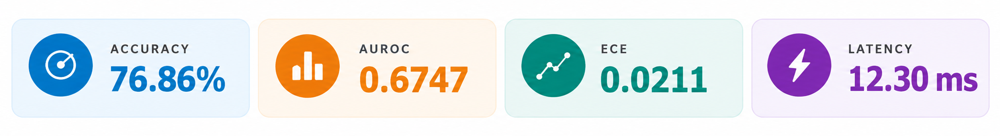
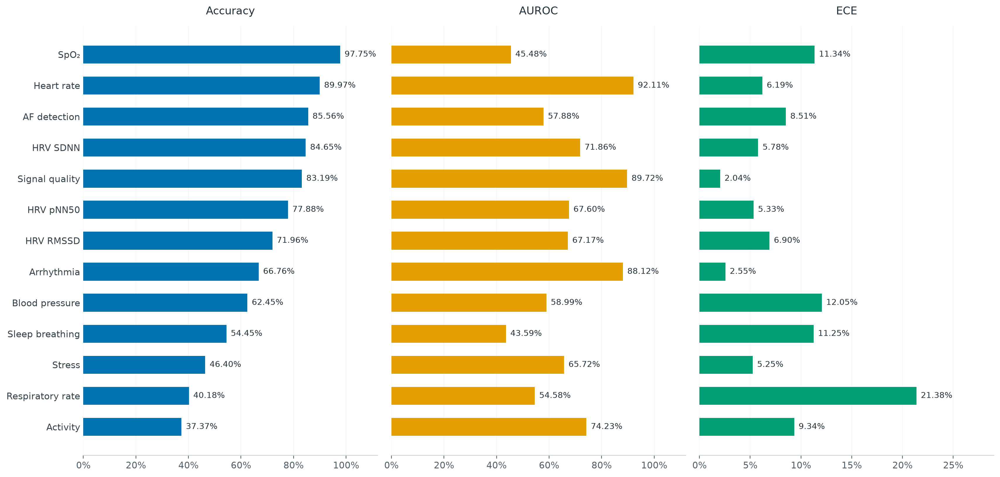

# Paya

**A non-autoregressive System 1 decision model for physiological signals.** Paya takes a physiological recording, a question and candidate answers. Frozen signal and text encoders feed a trained MLP fusion head with Hadamard product features. A single forward pass returns the selected answer, its confidence and a probability for each candidate. Our API supports PPG, ECG, EEG and iEEG signals, but the current model is trained and evaluated on normalized 10-second PPG at 125 Hz.



These results describe **Paya full-003, update 4,797, temperature 1**, evaluated on 323,944 PPG QA rows. AUROC is the mean of task macro AUROCs; ECE uses 15 confidence bins. Latency is the median batch-one public-API time on an RTX 2080 Ti with warm text embeddings and uncached signal encoding. See the [evaluation protocol and limitations](doc/results.md).

## Results by task



## Use

The model runtime uses **Python 3.12**. Install the recorded dependencies and the local package:

```bash
python -m pip install -r requirements-model.txt
python -m pip install -e .
```

Download the [Paya inference model](https://huggingface.co/yeabwang/Paya) into `models/export/` which contains the checkpoint, both encoders and the manifest needed by the loader.

```python
from paya.inference import load_model

model = load_model("models/export", device="cpu")

# ppg_samples: the 1,250 measurements from a processed 10-second PPG segment.
state = {"signals": [{
    "samples": ppg_samples,
    "metadata": {
        "sensor_type": "ppg",
        "sampling_rate_hz": 125,
        "duration_s": 10,
        "signal_condition": "processed",
    },
}]}

result = model.predict(
    state=state,
    question="What is the heart rate category?",
    criteria=["bradycardia", "normal", "tachycardia"],
)
# result: {"choice": ..., "confidence": ..., "probabilities": {...}}
```

Supply the actual waveform in `ppg_samples`. Use `device="cuda"` for a compatible GPU installation. CPU inference is supported; the published latency measures GPU inference. `signal_condition="processed"` bypasses physiological cleaning; raw inputs use the native-rate cleaning path.

## Documentation


| Document                            | Contents                                                                                                |
| ------------------------------------- | --------------------------------------------------------------------------------------------------------- |
| [Architecture](doc/architecture.md) | Input contract, processing flow, encoder internals, tensor dimensions and complete decision-head layers |
| [Experiments](doc/experiments.md)   | Development protocol, controlled comparisons, full-run recipe and checkpoint selection                  |
| [Fine-tuning](doc/finetune.md)      | How to prepare data, fine-tune pretrained weights, resume, calibrate and evaluate                             |
| [Results](doc/results.md)           | System and task metrics, definitions, calibration comparison, latency and coverage                      |
| [Model card](models/model.card.md)  | Model description, intended scope, training summary and checkpoint identity                             |

Exact evaluation values are in [doc/metrics.json](doc/metrics.json). The [checkpoint record](models/checkpoint.json), [runtime versions](models/runtime.json) and [verification record](models/verification.json) identify the released artifact.

## Repository layout

```text
paya/                 Supported model, input, training and inference code
tests/                Unit tests and pinned-encoder integration test
config/paya.yaml      Selected model and training settings
doc/                  Technical documentation, figures and evaluation metrics
models/               Model card and artifact identity records
```

For development, install the test extra and run:

```bash
python -m pip install -e ".[test]"
python -m pytest -q -m "not integration"
python -m pytest -q -m integration
```

The integration test requires the pinned pretrained assets.
