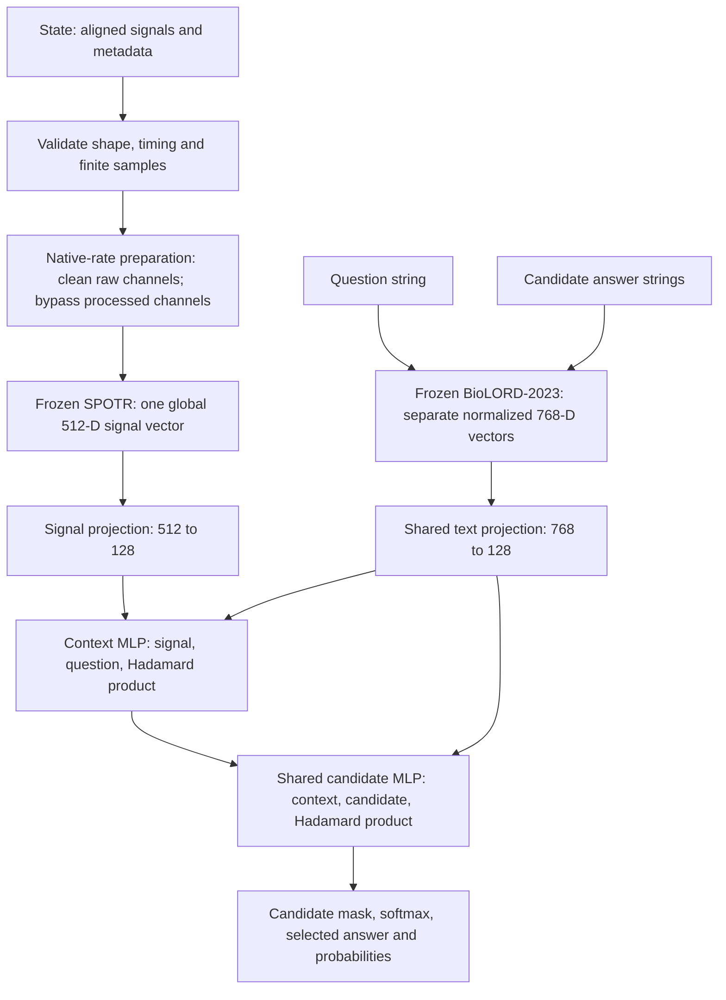

# Architecture

Paya is a non-autoregressive candidate-scoring model. It combines a frozen physiological signal encoder, a frozen biomedical text encoder and a supervised **MLP fusion head with Hadamard product features**. The head has **264,065 trainable parameters**. The released architecture and weights correspond to **full-003, update 4,797**.

## Processing flow



The full aligned recording is encoded once. Each question and candidate is encoded independently. Candidate scores are computed together; there is no token-by-token generation or autoregressive decoder. Metadata controls validation and preparation and is not concatenated into the learned head.

## Public input and output

The public method is `model.predict(state, question, criteria)`; see the [README example](../README.md#use).

| Input | Contract |
| --- | --- |
| `state.signals` | Ordered list of 1–128 physical channels |
| Channel `samples` | One-dimensional, finite numeric values; 2–12,800 samples per channel; representable in FP32 |
| `metadata.sensor_type` | PPG, ECG, EEG or iEEG; normalized to lowercase |
| `metadata.sampling_rate_hz` | Finite positive native sampling rate |
| `metadata.duration_s` | Finite positive duration consistent with sample count divided by sampling rate |
| `metadata.signal_condition` | `raw` or `processed`; defaults to `raw` |
| `question` | Nonempty string |
| `criteria` | Ordered list of 2–64 distinct nonempty answer strings |

All channels in one recording must have the same sampling rate, sample count and start time. Optional timestamps must match uniform native sampling. Channel order is preserved. The pipeline rejects incompatible timing, nonfinite measurements and excessive input sizes instead of filling gaps or silently truncating the recording. The text tokenizer also rejects strings exceeding its 128-token context, including special tokens.

The output contains `choice`, `confidence` and a dictionary of `probabilities` keyed by the supplied candidate strings. Confidence is the chosen candidate's softmax probability. An exact probability tie is resolved by lexicographic candidate text. The vocabulary is supplied per request; one shared head scores all tasks. Acceptance of a new candidate string or sensor type does not establish predictive validity for it.

## Signal preparation

Preparation retains native sampling rate and sample count. There is no external resampling, sliding-window segmentation or overlap. A processed channel bypasses NeuroKit cleaning. Raw channels receive the following native-rate processing:

| Modality | Waveform passed to the signal encoder |
| --- | --- |
| PPG | DC-preserving low-pass filter with cutoff `min(40, 0.4 × fs)` Hz |
| ECG | DC-preserving low-pass filter with cutoff `min(150, 0.4 × fs)` Hz |
| EEG | DC-preserving low-pass filter with cutoff `min(100, 0.4 × fs)` Hz; supplied reference retained |
| iEEG | DC-preserving low-pass filter at `0.4 × fs`; supplied reference retained |

For ECG, EEG and iEEG, an explicitly declared 50/60 Hz powerline band may be removed when supported by the native Nyquist limit. Cardiac beat detection and quality observations use separate detection signals; those observations do not replace the broad waveform, add decision-head features or supply supervised targets. Processed PPG used by the reported release skips these cleaning and detection operations.

## Frozen signal encoder

The pinned SPOTR Base encoder uses width **512**, **12 transformer blocks** and **8 attention heads**. For batch size `B`, channels `C` and native length `L`, its input is `[B, C, L]`.

1. Normalize each channel by its mean and standard deviation: `(x − mean) / (std + 1e-6)`.
2. Zero-pad the time axis internally to `Lp = 200 × ceil(L / 200)`.
3. Apply a convolutional stem: `Conv2d(1, 32, kernel=(1,25), padding=(0,12))`, LayerNorm2D, GELU, then `Conv2d(32, 512, kernel=(1,100), stride=(1,100))`, LayerNorm2D and GELU. Both convolutions omit bias.
4. Rearrange to `[B, C, N, 512]`, where `N = Lp / 100`, and add learned channel/patch positional embeddings.
5. Apply attention across patches within each channel and mean-pool to `[B, C, 512]`. Separately apply attention across channels within each patch and mean-pool to `[B, N, 512]`.
6. Concatenate a learned global token with these channel and patch summaries: `[B, 1+C+N, 512]`.
7. Process the sequence through 12 residual transformer blocks using RMSNorm, multi-head self-attention and a gated feed-forward network with hidden width 2,048 and SiLU gating.
8. Return only the global token to Paya: `[B, 512]`.

For the evaluated single-channel, 10-second, 125 Hz input, **1,250 samples → 1,400 padded samples → 14 patches → 16 transformer tokens → one 512-dimensional vector**. Internal padding does not change the declared recording duration. The decision head receives the global vector, not the complete patch sequence.

## Frozen text encoder

BioLORD-2023 encodes the question and every candidate separately using the pinned SentenceTransformer configuration. Mean pooling and embedding normalization produce 768-dimensional sentence vectors. Questions are `[B, 768]`; candidates are `[B, K, 768]`, with `K` the largest candidate count in a batch. Shorter candidate lists are padded and masked.

Both encoders remain in evaluation mode with gradients disabled, including when the decision head trains. Exact text strings can reuse frozen FP32 vectors cached on CPU. Questions and candidates share the same text encoder and learned text projection; they are not concatenated into one encoder prompt.

## Decision head

Let `s` be the global signal vector, `q` the question vector and `c_k` candidate `k`. Let `⊙` denote the element-wise Hadamard product and `[a;b;c]` concatenation. All projected vectors have width **128**.

```text
x   = GELU(Linear_512→128(LayerNorm_512(s)))
u   = LayerNorm_128(Linear_768→128(q))
v_k = LayerNorm_128(Linear_768→128(c_k))       # same text-projection weights as u

h   = Dropout_0.1(GELU(Linear_384→128([x; u; x ⊙ u])))
z_k = Linear_128→1(
        Dropout_0.1(GELU(Linear_384→128([h; v_k; h ⊙ v_k])))
      )
p_k = softmax(z / T)_k
```

The candidate scorer is shared across `k`; it is not a separate fixed classifier for each task. The signal/question product allows learned cross-feature dependencies when forming the context. The context/candidate product provides the corresponding dependencies during scoring. Concatenation also preserves each individual vector. Permuting candidates permutes their logits and probabilities; it does not change the underlying scoring function.

| Head component | Layers, in order | Output | Trainable parameters |
| --- | --- | --- | ---: |
| Signal projection | LayerNorm(512), Linear(512,128), GELU | `[B,128]` | 66,688 |
| Shared text projection | Linear(768,128), LayerNorm(128) | `[B,128]` and `[B,K,128]` | 98,688 |
| Context MLP | Linear(384,128), GELU, Dropout(0.1) | `[B,128]` | 49,280 |
| Candidate MLP | Linear(384,128), GELU, Dropout(0.1), Linear(128,1) | `[B,K]` | 49,409 |
| **Total** | | | **264,065** |

Linear layers include biases. LayerNorm has learned scale and bias. The context is broadcast across candidates; its parameters are counted once. The head input retains a singleton signal-token axis `[B,1,512]` and an all-valid `[B,1]` mask. Invalid candidate positions receive negative-infinite logits before softmax or loss calculation. Dropout is active only during training. The release uses **T = 1**; temperature scaling is documented separately in [Results](results.md#calibration).

## Caching, checkpoints and runtime

Frozen signal features can be stored in a disk-backed SQLite cache and encoded in batches when native shapes match. Cache identities bind the frozen assets and preparation, not the trainable head. Caching avoids repeated encoder computation; it does not change the public input or the head architecture. Public `predict` does not use this signal-feature cache, and the reported latency includes fresh signal encoding.

The decision checkpoint contains head weights, temperature, architecture/asset/preparation identity and optional recovery state. Frozen encoder weights are separate assets. `load_model` verifies the inference manifest, every listed file checksum and the checkpoint identity before loading. Changing preprocessing dependencies, assets or head dimensions can invalidate that identity. The saved kind string `interaction` is retained for serialization compatibility; the implementation is `MLPFusionHead`.

| Asset | Pinned revision |
| --- | --- |
| SPOTR, `5gyyyyy/SPOTR` | `5a963ffaca341c6d875c69713133de526f6b905b` |
| SPOTR implementation | `57b3c9f47cc7d20bc9852b84df9545f1dbb887f6` |
| BioLORD-2023, `FremyCompany/BioLORD-2023` | `167aab527b238a50ca65224e6319215d2ff4fc9f` |

The verified runtime uses Python 3.12; package versions are recorded in [models/runtime.json](../models/runtime.json) and [requirements-model.txt](../requirements-model.txt). The GPU measurement used PyTorch 2.8.0+cu128. Upstream attribution and license records accompany the encoder assets and [vendor implementation](../paya/vendor/SOURCE.md).

## Implementation map

| Module | Responsibility |
| --- | --- |
| [inputs.py](../paya/inputs.py), [preprocessing.py](../paya/preprocessing.py), [physiology.py](../paya/physiology.py) | Input validation, preparation identity and native-rate cleaning |
| [encoders.py](../paya/encoders.py), [vendor/spotr.py](../paya/vendor/spotr.py), [text.py](../paya/text.py) | Frozen encoders and separate text vectors |
| [head.py](../paya/head.py), [model.py](../paya/model.py) | Fusion layers, batching, candidate masks and prediction |
| [data.py](../paya/data.py), [features.py](../paya/features.py), [train.py](../paya/train.py) | Bounded data loading, frozen-feature caching and supported training |
| [checkpoint.py](../paya/checkpoint.py), [inference.py](../paya/inference.py) | Identity-checked checkpoint and inference loading |

See [Experiments](experiments.md) for the historical attention architecture and controlled comparisons. The reported accuracy validates only processed 10-second PPG at 125 Hz; it does not validate every accepted input configuration.
