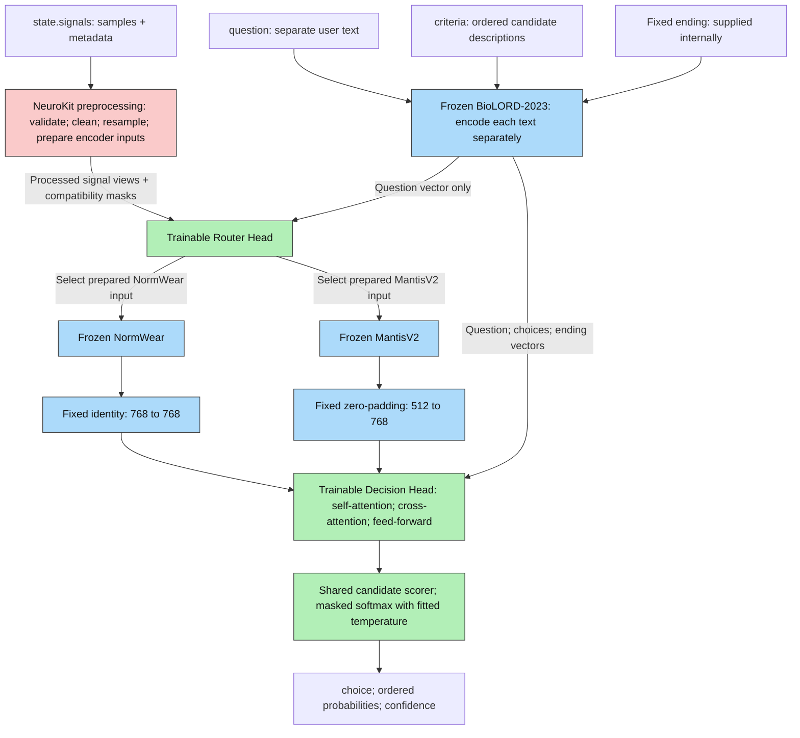

# Paya architecture fix: contextual signal preparation and a shared decision model

Research and implementation revision date: 19 October 2026. Status: replacement architecture implemented; synthetic shape, boundary, gradient, checkpoint, and pipeline checks completed. Ready for implementation review before retraining and model-performance testing. This revision follows the supplied diagram: NeuroKit preprocessing first, then a trainable router, a selected frozen signal encoder, and one trainable decision head. BioLORD is frozen. Encoder-output dimension adapters are fixed and have no trainable parameters. The new router/head are not trained or outcome-calibrated. See [implementation review notes](implementation-review.md).

## 1. Decision and boundaries

Build a **question-conditioned, sparsely routed encoder system with one shared discriminative decision head**. The two signal encoders for the current work are **NormWear and MantisV2**, both frozen. Freeze BioLORD-2023 for text. Train only the router and the decision head, including the head's ordinary attention, text-input, and scoring weights. Use standard bidirectional self-attention, cross-attention, and feed-forward layers.

The stage order is:

`state.signals (samples + metadata) -> NeuroKit preprocessing -> router(processed signal, question) -> selected frozen encoder -> fixed dimension adapter -> shared decision head`.

The public inputs are three separate arguments: `state`, `question`, and ordered `criteria`. The question and candidate answers are not embedded inside `state` or concatenated into a single text prompt. BioLORD encodes them separately; the model supplies the fixed ending internally.

The supplied metadata already identifies the signal and its acquisition rate. It directly configures the deterministic preprocessing; the router does not learn to guess those fields or choose resampling parameters. Its learned task is to choose between the two already prepared encoder inputs according to the processed waveform and the question.

The decision head receives only:

1. Encoded waveform vectors from the selected frozen signal encoder, placed in a common 768-dimensional input format by an identity operation or zero-padding.
2. BioLORD vectors for the question, each candidate answer, and the fixed ending.
3. Boolean padding masks and sequence structure needed to operate on those tensors.

**No sensor metadata vector enters the decision head or the learned router.** Sampling rate, units, sensor type, axes, placement, lead labels, timestamps, acquisition filtering, and quality checks configure preprocessing and its deterministic compatibility checks. The router sees the resulting waveforms, the question vector, and structural/compatibility masks. Dataset, subject, device, and split identifiers remain audit fields only.

**Encoder selection is closed for this work.** Implement and validate the NormWear/MantisV2 system. Searching for, benchmarking, adding, or swapping other encoders is future work and is not a condition for implementing this architecture. Validation still measures whether the selected system answers supported questions accurately, with calibrated probabilities and acceptable latency; selecting an encoder is not itself a performance result.

### Proposed computation



All signal cleaning, unit conversion, rate conversion, and framing happen inside the NeuroKit preprocessing stage **before the router**. Because the two encoders expect different inputs, that stage retains an information-preserving cleaned source and prepares the compatible input view for each encoder. For example, it can prepare a 65 Hz NormWear view and a higher-rate Mantis view from the same ECG. The router selects the appropriate prepared view; it does not request a second round of preprocessing. Preparing two waveform views does not execute two frozen encoders.

The earlier physical-metadata summary was an optional gate input, not a requirement of routing. It is removed. The earlier encoder-specific learned projections could have adapted feature bases, but they are also optional. Section 8 replaces them with explicit fixed dimension adapters and leaves task learning inside the green decision head.

At inference, select one encoder for the request and evaluate only that branch. Encode all selected channels/windows in a batch and score all candidates together. This is one non-autoregressive decision computation, with no generated reasoning, sampling loop, candidate-by-candidate model execution, or iterative expert search. It is not a claim that CPU preprocessing, BioLORD, the router, the waveform encoder, and the head are literally one matrix operation.

## 2. Problems verified in the retired implementation

| Retired location | Observed behavior | Replacement architectural change |
| --- | --- | --- |
| `paya/inputs.py`: `TYPES`, `physical_metadata()` | Sensor type has an `unknown` category; absent or unrecognized types map into it. | Require one of the nine supported types; reject missing, blank, null, or unknown values. |
| `paya/inputs.py`: `prepare_signal()` | Converts a rate with `float(...)`, checks 1–4000 Hz, converts some units, and requires shared channel lengths/rates. | Validate numeric types explicitly, including rejecting booleans; validate physical streams before encoder-specific resampling. Permit documented low-rate streams through an appropriate profile. |
| `paya/model.py`: `GroundedChoiceHead.sensor_proj` | Adds a learned metadata projection to every signal token. | Delete this path in the replacement head and its input signature. |
| `paya/vendor/normwear.py`: `NormWear.forward()` | Computes differences and CWT on sample indices without receiving a sampling rate. | Apply a verified physical-rate preparation contract before calling this encoder. |
| `paya/model.py`: `signal_memory()` | Pools to eight temporal bins and 13 wavelet-scale bins per channel. | Treat this as lossy temporal pooling, suitable only for profiles validated with that compression. |
| `paya/model.py`: `EvidenceAttention` | Implements multi-head cross-attention with normalized queries/keys and a learned bounded scale. | Name the operation by its actual mathematics; the new default uses scaled dot-product attention. |
| `paya/data.py`, `features.py`, `inference.py` | Cache, batch, and inference interfaces assume one NormWear representation and pass metadata into scoring. | Use route/profile-specific feature contracts and the new metadata-free head interface. |

The retired rate check already rejected many invalid rates; the issue was not that every invalid value was accepted. It did not establish compatibility with NormWear's physical training preparation. Likewise, having all nine labels in an enum is not evidence of learned competence on all nine signals. The retired source and its tests, configs, deployment scripts, examples, and benchmark results are preserved at `C:\jev\retired\paya-20261019-architecture-v1`, outside this project. Only the fixed vendor frontend and the frozen BioLORD loading component were retained, with the text cache contract revised for the separate-text interface.

Existing local checkpoints, calibration results, feature caches, and reported latency describe the old computation. They cannot validate this replacement architecture.

## 3. Strict input contract

### Approved public interface

```python
state = {
    "signals": [
        {
            "samples": ecg_samples,
            "metadata": {
                "sensor_type": "ecg",
                "sampling_rate_hz": 500,
                "unit": "mV",
                "lead": "II",
            },
        }
    ]
}

question = "Which heart-rate category describes this signal?"

criteria = [
    "Slow heart rate",
    "Normal heart rate",
    "Fast heart rate",
]

result = model.predict(
    state=state,
    question=question,
    criteria=criteria,
)
```

This is the target interface for the architecture; it has not yet been implemented in the current runtime. `ecg_samples` represents the complete finite signal window, not a textual description of it.

| Argument | Required format | Meaning |
| --- | --- | --- |
| `state` | Object containing a nonempty `signals` list | The body-signal measurements and their physical metadata |
| `state.signals[i].samples` | One-dimensional numeric sequence | Samples for one physical channel |
| `state.signals[i].metadata` | Object with required sensor type/rate and relevant physical descriptors | Direct configuration for that channel's NeuroKit preparation |
| `question` | Nonempty string | The user's question, supplied separately from the state and candidates |
| `criteria` | Ordered list of 2–64 distinct, nonempty strings | The user-provided candidate answer descriptions, in output probability order |

Each physical channel has its own `samples` and `metadata` entry. There is one question and one ordered candidate list per call. The fixed ending is an internal constant, not a required user argument. This contract does not introduce a named multi-question dictionary or additional answer types.

### Required fields

Each entry in `state.signals` must carry `samples`, an explicit `metadata.sensor_type`, a numeric `metadata.sampling_rate_hz`, and the physical descriptors needed by its preparation contract. Use this exact canonical vocabulary:

`ecg`, `eeg`, `accelerometer`, `gyroscope`, `ppg`, `eda`, `respiration`, `temperature`, `emg`.

Case and surrounding whitespace may be normalized. Thus `" ECG "` becomes `"ecg"`. Reject `"unknown"`, `""`, whitespace-only strings, `null`, missing fields, and unrecognized types. Do not infer type from the waveform or silently map a typo to another type. External aliases such as EKG, GSR, and RSP require an explicit, versioned import adapter; they are not additional public enum values.

For sampling rate, require a real numeric scalar that is finite and strictly positive. Reject booleans, strings such as `"65"` or `"unknown"`, empty strings, nulls, zero, negatives, NaN, and infinity. Do not default to 65 Hz. A valid numeric rate still needs a compatible processing profile; reject an unsupported rate/task combination before inference. Low-rate EDA or temperature can be below 1 Hz, so the existing global 1 Hz minimum should not define physiological validity.

Require the rate inside every channel's `metadata`, even when all channels share the same rate. Heterogeneous streams also need a shared time reference. A top-level rate is not a substitute for a missing channel rate in this public format. Do not stack asynchronous streams merely because their arrays have equal lengths.

### Physical checks

- Require nonempty one-dimensional finite samples. Reject empty arrays and unexplained missing intervals. Do not let a downstream library silently fill NaNs before validation.
- Check rate against supplied timestamps, duration, and acquisition history. Reject materially inconsistent declarations; timestamps are not a reason to guess an absent required rate.
- Convert known units before model-specific preparation: ECG to mV; EEG/EMG to µV; acceleration to m/s²; angular velocity to rad/s; EDA to µS; temperature to °C. PPG and respiration need their documented measurement convention, which may be device-relative rather than an absolute physical unit.
- Never relabel already normalized data as a physical measurement. Reject absolute-level questions when original units, gain, or reference have been lost.
- Require axes/frame information for axis-dependent inertial questions and lead/montage information for spatial electrical questions. Missing irrelevant optional fields may be allowed; missing decisive fields cannot be replaced with an `unknown` embedding.
- Bound channels, samples, duration, encoder frames, and token count using an advertised deployment budget. A finite rate alone does not authorize an arbitrarily large request.

Validate `question` independently from `criteria`. Require 2–64 distinct, nonempty strings in the ordered `criteria` list; reject duplicates after the chosen whitespace normalization while retaining original descriptions and order for output. Check the question and each criterion separately against the pinned BioLORD token limit. Do not concatenate them into one prompt or silently truncate decisive wording. The current local BioLORD configuration has a 128-token sentence limit and mean pooling to 768 dimensions.

Successful outputs contain exactly `choice`, `probabilities`, and `confidence`, and assume a single categorical answer among the supplied candidates. Training examples must satisfy that meaning. Nonexclusive or incomplete alternatives can invalidate that interpretation even when their strings pass validation. If “insufficient evidence” is a supported outcome, include and train it as an explicit candidate. Invalid or unsupported requests are handled through request-boundary errors separately from the three-field prediction payload, without invented probabilities.

## 4. What NormWear actually does

### Published preparation and limits

NormWear's appendix describes **65 Hz, six-second segments, linear detrending, and Gaussian smoothing with σ = 1.3 samples (approximately 0.02 s)**. This is the preparation distribution to reproduce as a baseline. It is not an assertion that every signal sampled at 65 Hz retains everything a question might require. [NormWear paper, appendix B.1](https://arxiv.org/html/2412.09758v2#A2.SS1)

At 65 Hz, Nyquist is 32.5 Hz. Further, the published smoothing attenuates frequencies below that limit. For illustration, an ideal continuous Gaussian with σ = 0.02 s has magnitude response `exp(-2*pi²*σ²*f²)`, approximately 0.043 at 20 Hz. This is an analytic approximation, not a measurement of the exact discrete implementation. A “below Nyquist” check is therefore insufficient for routing a task safely to this profile.

The reference wrapper declares 65 Hz but only attempts resampling for original rates above 256 Hz. Its behavior does not provide consistent physical canonicalization for all input rates. Implement an explicit adapter and verify it; do not copy that conditional as the new rate policy. [NormWear reference wrapper](https://raw.githubusercontent.com/Mobile-Sensing-and-UbiComp-Laboratory/NormWear/main/main_model.py)

The published pretraining covers multiple physiological and inertial datasets; that establishes a useful prior, not guaranteed generalization to any sensor or question. [Official NormWear repository](https://github.com/Mobile-Sensing-and-UbiComp-Laboratory/NormWear)

### Retained encoder and dimensions

The existing Paya vendor code is pinned to Hugging Face revision `c35a3d1ecda1cb971f1f89caaa3ee4b4c6ad8e84`. Preserve this identity unless an explicitly tested migration replaces it. Its mathematical stages are:

| Stage | Input | Output |
| --- | --- | --- |
| Prepared waveform frames | Physical streams, resampled and framed | `[B, W, C, 390]` for complete six-second frames at 65 Hz |
| Finite differences, alignment | `[B*W*C, 390]` | `[B*W*C, 3, 388]`: waveform and first/second differences |
| Existing Ricker CWT | `[B*W*C, 3, 388]` | `[B*W*C, 3, 389, 65]` with the current even-kernel padding rule |
| Conv2D patch embedding, kernel/stride `(9,5)` | `[B*W*C, 3, 389, 65]` | `[B*W*C, 43*13, 768]` |
| Frozen positions and prepended CLS | `[B*W*C, 559, 768]` | `[B*W*C, 560, 768]` |
| 12 frozen Transformer blocks | `[B*W*C, 560, 768]` | Same shape; 12 self-attention heads of width 64 |
| Inter-channel CLS self-attention at configured fusion blocks | `[B*W, C, 768]` | `[B*W, C, 768]`, reinserted into the corresponding channel sequences |
| Final LayerNorm and regrouping | `[B*W*C, 560, 768]` | `[B, W, C, 560, 768]` |
| Optional existing temporal average pooling | CLS plus a `43 x 13` grid per channel/frame | `[B, W, C, 105, 768]`, where `105 = 1 + 8*13` |

Inside each frozen NormWear block, LayerNorm preserves the input width; the Q/K/V projection maps `768 -> 2304`, split into 12 heads of width 64. Self-attention returns width 768, followed by a residual addition. The feed-forward network maps `768 -> 3072 -> 768` with GELU and a second residual addition. Both sublayers preserve the sequence length. The inter-channel CLS blocks use the same widths with sequence length `C` rather than 560. These dimensions come from the local pinned configuration and `paya/vendor/layers.py`.

These exact CWT dimensions describe **the local implementation**, including its padding convention. The paper's description of scales and the optimized code's scale bank are not interchangeable specifications. The current optimized code creates 65 scales starting at 0.1 in unit steps. Keep waveform/CWT numerical parity tests when changing the frontend. [Local source attribution](../paya/vendor/SOURCE.md), [reference CWT and training loader](https://raw.githubusercontent.com/Mobile-Sensing-and-UbiComp-Laboratory/NormWear/main/pretrain_pipeline/dataset.py)

Do not compute a scalogram externally and then pass it into `NormWear.forward()` as though it were a waveform. The retained encoder already performs differencing and CWT. Do not multiply finite differences by sampling-rate factors without retraining: that changes the pretrained frontend's input distribution.

### Appropriate use

Use the published profile as a low-bandwidth dynamic-signal baseline. Do not route detailed ECG intervals/morphology, high-frequency EEG, raw EMG spectra, absolute temperature, tonic EDA level, or gravity-dependent orientation to it just because the arrays fit. Detrending removes level/trend information; smoothing and rate reduction remove temporal detail. There is no downstream attention layer that can reconstruct information eliminated upstream.

Additional NeuroKit cleaning, different smoothing, envelopes, and altered windows are new preparation profiles. Compare them with the reference preparation instead of calling them equivalent to pretrained NormWear.

## 5. The two selected frozen signal encoders

| Encoder | Role in this architecture | Output before fixed formatting |
| --- | --- | --- |
| NormWear | Wearable-specific multichannel representations from its prepared low-rate input | 768-dimensional vectors |
| MantisV2 | General time-series representations from a prepared signal that retains the relevant level and bandwidth | 512-dimensional combined vectors |

These are the two signal encoders to implement now. BioLORD is the separate frozen text encoder. No additional signal-encoder comparison, third encoder, or swap is planned in this scope.

### Why MantisV2 complements NormWear

Its token generator includes scalar encodings of **unnormalized patch means and standard deviations**, in addition to normalized waveform/difference convolutions. Thus level/scale has an encoder path without passing metadata or a handcrafted feature vector into the head. This is a structural advantage for the requested interface; it is not proof those quantities can be decoded accurately on our tasks. [MantisV2 token generator](https://raw.githubusercontent.com/vfeofanov/mantis/main/src/mantis/architecture/version2.py)

Use `paris-noah/MantisV2`, `return_transf_layer=2`, `output_token="combined"`, and `pre_training=False` as the starting frozen feature extractor. The public intermediate-layer recommendation comes from time-series classification experiments, not this body-signal QA task. Use one representation, without the paper's optional perturbation ensembles or extra vision encoders. [Official Mantis usage and checkpoints](https://github.com/vfeofanov/mantis)

For a batch of `R` single-channel frames:

| Stage | Input | Output |
| --- | --- | --- |
| Prepared single-channel frame batch | Selected streams | `[R, 1, 512]` baseline |
| Frozen token generator | `[R, 1, 512]` | `[R, 32, 256]` |
| Append frozen CLS | `[R, 32, 256]` | `[R, 33, 256]` |
| First three frozen Transformer blocks, indices 0–2 | `[R, 33, 256]` | `[R, 33, 256]` |
| Concatenate CLS and mean of 32 patch states | Two `[R, 256]` tensors | `[R, 512]` |
| Pack frames/channels by request | `[R, 512]` | `[B, M_M, 512]` plus padding mask |

For the public default configuration, each of the three retained frozen blocks has the following internal dimensions. The source temporarily represents the singleton channel axis explicitly; the table suppresses that axis for readability.

| Frozen Mantis block layer | Input | Output |
| --- | --- | --- |
| RMSNorm | `[R,33,256]` | `[R,33,256]` |
| Self-attention with rotary positions | Q/K/V each `[R,8,33,32]`; scores `[R,8,33,33]` | `[R,33,256]` after output projection |
| Residual, then RMSNorm | Two `[R,33,256]` states | `[R,33,256]` |
| Gated feed-forward projection | `[R,33,256]` | `[R,33,1024]` |
| SwiGLU | `[R,33,1024]` | `[R,33,512]` |
| Feed-forward output projection and residual | `[R,33,512]` projected back and added to the residual | `[R,33,256]` |

Verify these against the pinned checkpoint configuration before loading weights; constructor defaults and descriptive docstrings can disagree. [Mantis Transformer implementation](https://raw.githubusercontent.com/vfeofanov/mantis/main/src/mantis/architecture/transformer_v2_utils/transformer.py)

Here `R` is the total number of real channel/frame pairs in the batch, and `M_M` is their maximum count per request. Mantis is channel-independent; the shared head must learn interactions across its returned channel/frame vectors. The selected 512-dimensional output is a concatenation of two 256-dimensional vectors, not a 512-dimensional patch hidden state.

The model supports lengths divisible by 32, but the initial profile uses 512. Avoid single-sample patches: unbiased patch standard deviation is undefined there. Other lengths require explicit profile validation, not silent resizing. The implementation pins `mantis-tsfm==1.1.0` and checkpoint revision `8f6ca35cb54ab14b120618943c6fca5ddf5a76a6`. The actual frozen checkpoint has passed the synthetic shape check at the selected extraction layer and scalar settings.

There is no declared “maximum supported physical Hz” in this generic encoder. Preserve task bandwidth in its input and then test whether its representation retains the needed information. **Accepting a 4 kHz waveform tensor is not evidence of generalization to 4 kHz EMG.**

## 6. NeuroKit preprocessing comes before routing

The user supplies the sensor name, sampling rate, units, and other acquisition details. Validate those declarations and use them directly to configure NeuroKit. These are physical facts, not labels for a network to infer. The preprocessing stage has no trainable weights and does not depend on the candidate answers.

NeuroKit is the primary physiological processing toolkit. Its `bio_process` wrapper dispatches ECG, respiration, EDA, EMG, PPG, and EOG routines. EEG has MNE-oriented utilities; inertial axes and temperature need explicit adapters around generic signal operations. Thus the project prepares the nine supported types with the applicable NeuroKit functions rather than assuming one `bio_process` call handles every modality. EOG remains outside Paya's supported vocabulary. [NeuroKit dispatch source](https://neuropsychology.github.io/NeuroKit/_modules/neurokit2/bio/bio_process.html), [EEG utilities](https://neuropsychology.github.io/NeuroKit/functions/eeg.html)

### What preprocessing returns

For each request, preprocessing returns a bundle containing:

- The cleaned, physically canonical source streams, retained until preparation is complete.
- A prepared NormWear waveform view when physically compatible.
- A prepared MantisV2 waveform view when physically compatible.
- A two-element compatibility mask and structural channel/frame masks.
- An audit record of conversions and settings. This record does not enter either learned module.

Both views are produced **before** the router. They are alternative preparations of the same measured interval for the two fixed encoders, not two learned branches or additional encoders. Validation and physical unit conversion are performed once. Rate-dependent filtering is applied independently to each view, so NormWear's smoothing never overwrites the higher-rate source used for Mantis.

This is how the diagram supports contextualized processing without moving the router ahead of NeuroKit: preprocessing preserves the required alternatives, the question-conditioned router chooses which prepared representation to encode, and cross-attention in the decision head selects relevant encoded content. The waveform preparations themselves are reproducible functions of metadata and the fixed encoder contracts. The router does not select among six processing actions, invent cutoffs, or send work back to preprocessing.

### Deterministic preparation order

1. Validate the nine-type enum, numeric rate, finite samples, timing, units, and channel descriptors. Reject missing/nonfinite samples and inconsistent intervals. Record flatlines and observed minima/maxima before cleaning; observed extrema alone do not establish acquisition clipping.
2. Convert physical units and apply only justified coordinate/reference transformations. Preserve DC level, morphology, and the broad measured signal unless a particular encoder view explicitly removes them.
3. Apply an explicit fourth-order zero-phase NeuroKit Butterworth low-pass at the original rate, with cutoff `0.4*min(native_rate, view_rate)`. The baseline applies no high-pass, notch, per-window z-score, peak/rate channels, or task-specific automatic cleaning defaults. Modality determines the physical unit and target rate. Additional modality cleaning needs a separately validated preparation change.
4. Prepare the NormWear view using its fixed rate and signal-processing contract. Prepare the Mantis view independently from the retained source using the fixed rate for that modality. An incompatible view is marked unavailable rather than fabricated.
5. Apply time-preserving polyphase rate conversion, then frame each view. Track real interval coverage and boundaries. Use the filter's boundary context and return only the requested interval. Mantis uses 256-sample strides and a final overlapping complete frame when needed. NormWear uses complete 390-sample frames with 390-sample strides and a final complete overlapping frame when needed.
6. Validate each prepared view, produce compatibility/structural masks, and hand the completed bundle to the router. After selection, the chosen waveform goes directly into its frozen encoder.

Use the SciPy polyphase operation underlying `nk.signal_resample(..., method="poly")`, with explicit `padtype="line"` boundary handling and the rounded target length. The NeuroKit wrapper does not expose that boundary setting; its default zero extension changed a constant temperature level in the implementation checks. This setting preserves DC without extending the returned measurement interval. Verify resulting length/rate and passband. The default interpolation method is not the selected downsampling policy. Upsampling can meet an input format but cannot restore missing bandwidth. [NeuroKit resampling implementation](https://neuropsychology.github.io/NeuroKit/_modules/neurokit2/signal/signal_resample.html)

NeuroKit cleaning defaults are consequential: ECG methods have different filtering goals, and the documented EMG default includes a 100 Hz high-pass filter. Specify methods, rate, powerline settings, filter order/phase, and parameters in the preparation contract. Do not use peak-detection cleaning as a universal morphology-preserving operation. [ECG cleaning](https://neuropsychology.github.io/NeuroKit/_modules/neurokit2/ecg/ecg_clean.html), [EMG cleaning](https://neuropsychology.github.io/NeuroKit/_modules/neurokit2/emg/emg_clean.html)

### Preparation for the nine supported types

The rates below are explicit design settings for this system, not pretrained Mantis sampling-rate requirements or measured performance claims. Keep the Mantis view broad and level-preserving where the question could require those properties. All NormWear views use 65 Hz and six-second framing; the router makes the contextual choice after preparation.

| Type | Metadata-driven preparation before the router | Mantis view | NormWear view and contextual use |
| --- | --- | --- | --- |
| ECG | Convert to mV, preserve the supplied lead/reference, use only specified cleaning; retain morphology | 500 Hz, 512-sample frames | Reference preparation for coarse dynamic questions; precise intervals/morphology use Mantis |
| EEG | Convert to µV, handle the documented montage/reference, retain supported measured bands | 500 Hz, 512-sample frames | Low-band dynamic view only; higher-frequency questions require Mantis |
| Accelerometer | Convert to m/s²; preserve signed axes and gravity; align a known coordinate frame | 100 Hz, 512-sample frames | Dynamic motion view; orientation/gravity questions use the preserved Mantis view |
| Gyroscope | Convert to rad/s; preserve signed axes and the coordinate convention | 100 Hz, 512-sample frames | Coarse dynamics view; detailed rotation uses Mantis |
| PPG | Preserve the declared device-relative intensity convention and pulse shape; explicit cleaning/QC | 125 Hz, 512-sample frames | Coarse pulse dynamics; detailed pulse-shape/timing questions use Mantis |
| EDA | Convert to µS; retain tonic level and slow variation | 32 Hz, 512-sample frames | A dynamic view where supported; tonic/absolute-level questions use Mantis |
| Respiration | Preserve the declared depth/unit convention; use the explicit low-pass contract above | 32 Hz, 512-sample frames | Short dynamic view where sufficient; slow/longer questions use Mantis and enough real cycles |
| Temperature | Convert to °C; preserve DC level and trend; only justified despiking/smoothing | 32 Hz, 512-sample frames | Reference detrending is incompatible with absolute-level/trend tasks; mark that view unavailable for this release |
| EMG | Convert to µV; preserve raw measured bandwidth for Mantis; an activation envelope may be a separately documented NormWear input representation | 2000 Hz, 512-sample frames | Raw high-band EMG is incompatible; enable an envelope view only when that preparation is validated within this selected system |

For example, 32 Hz temperature framing covers 16 seconds per 512-sample frame. A 1 Hz source still contains only its genuine observations; interpolation adds no new measurement evidence. The electrical/inertial rates above also limit the representable passband. Require a transition-band margin below output Nyquist and sufficient acquisition bandwidth. These preparations do not establish support for arbitrary raw EMG frequencies or all EEG tasks.

Do not append every NeuroKit-derived channel. Peak/rate outputs can support preparation checks; direct HR/HRV values and QC tables are not extra decision-head inputs. Tonic/phasic decompositions and EMG envelopes are distinct signal representations and must not replace the broad Mantis view indiscriminately. [EDA decomposition](https://neuropsychology.github.io/NeuroKit/_modules/neurokit2/eda/eda_phasic.html), [respiration cleaning](https://neuropsychology.github.io/NeuroKit/_modules/neurokit2/rsp/rsp_clean.html)

For Mantis, form complete 512-sample frames with fixed, documented overlap. Cover a trailing interval with a final overlapping complete frame rather than silently dropping it. Do not insert zero-padded samples into its frozen encoder: padding changes raw patch statistics. Reject insufficient real duration. Pad only the encoded vectors when batching the decision head. Likewise, do not invent absent sensor channels for NormWear.

A mixed-modality request is eligible for an encoder only if all streams needed for its supported question have compatible prepared views and the budget permits them. For Mantis, different modality rates may yield different frame counts; batch their real 512-sample frames and retain prepared-grid alignment. One encoder is selected for the request. Reject unsupported coverage rather than silently drop required channels or run both encoders at inference.

### Same ECG, different questions

| Question | What happens after preprocessing |
| --- | --- |
| “Is the heart rate broadly slow, normal, or fast?” | The router may select the already prepared NormWear view for a supported coarse decision. |
| “Is the QRS complex narrow or wide?” | The router selects the already prepared morphology-preserving Mantis view. |
| “Is HRV low or high over this interval?” | The system requires adequate original duration and timing precision; resampling cannot make a short window adequate. |
| “Is this ST segment elevated?” | The acquisition, lead, reference, units, and preserved bandwidth must support the task; the broad view must not have been overwritten by peak-detection filtering. |

Routing behavior is learned and evaluated on these distinctions; this table specifies the intended behavior, not a guarantee that an untrained router understands every free-form question. The preparation and supported-task contracts define what can be answered.

## 7. Router after NeuroKit: purpose, inputs, and dimensions

The router is a **two-expert top-1 gating network**. It chooses NormWear or MantisV2 using the already processed waveforms and the frozen BioLORD question embedding. Preprocessing answers “what was measured and how must it be formatted?” The router answers “which of our two prepared encoder inputs is appropriate for this question and waveform?” These are different operations.

There is no learned physical-metadata summary, no direct metadata input, and no trainable resampling/filter selection. Compatibility is computed by preprocessing and supplied as a Boolean mask `[B,2]`. Candidate answers and the ending do not enter the router.

A small one-dimensional convolutional network inside the green Router Head can read each prepared view. Its pooled vectors are **learned waveform features**, not metadata embeddings or the output of either frozen signal encoder. This keeps the gate upstream of expensive signal encoding while giving it actual signal input as drawn.

| Router operation | Input | Output | Parameters |
| --- | --- | --- | --- |
| Prepared real frames, grouped by view | NormWear `[R_N,1,390]`; Mantis `[R_M,1,512]` | Same waveforms | None; already produced by NeuroKit preprocessing |
| Shared Conv1D, kernel 9, stride 2, padding 4; GELU | `[R_j,1,L_j]` | `[R_j,16,ceil(L_j/2)]` | Trainable inside router |
| Shared Conv1D, kernel 5, stride 2, padding 2; GELU | Previous frame features | `[R_j,32,ceil(L_j/4)]` | Trainable inside router |
| Mean pool over the real temporal positions | NormWear `[R_N,32,98]`; Mantis `[R_M,32,128]` | `[R_j,32]` | None |
| Mean pool real frame/channel vectors within each request and view | Per-frame features | `[B,2,32]`, flattened to `[B,64]` | None |
| Frozen BioLORD question encoding | Tokenized question | `[B,768]` | Frozen |
| Question linear projection and GELU | `[B,768]` | `[B,128]` | Trainable inside router |
| Concatenate waveform and question features | `[B,64]` and `[B,128]` | `[B,192]` | None |
| Linear and GELU | `[B,192]` | `[B,64]` | Trainable inside router |
| Linear expert logits | `[B,64]` | `[B,2]` | Trainable inside router |
| Apply compatibility mask and softmax | Logits and mask `[B,2]` | `[B,2]` route probabilities | None |
| Argmax and dispatch the selected prepared waveform | `[B,2]` | `[B]` expert indices | None |

`R_N` and `R_M` count real channel/frame pairs across requests. No fake channels or sample padding are passed through the waveform convolutions. An unavailable view has no frames, its pooled slot is zero, and its expert logit is masked. An all-masked request returns unsupported before softmax. A request with only one compatible expert has a deterministic dispatch.

The router uses the same convolution weights for both prepared views. Grouping and pooling are invariant to a permutation of physical channels. Their purpose here is economical expert selection; these pooled router features never enter the decision head. The selected waveform still passes through the full frozen encoder.

Prepare the two views before routing, but execute **only the selected frozen signal encoder at inference**. Include both waveform preparations and the small router in end-to-end latency. A cached prepared bundle can be reused when asking different questions about the same signal.

### Training the router with the two selected encoders

`argmax` dispatch is discrete. Backpropagation through that operation does not automatically train expert selection. Train the green head and gate using outcomes from the two fixed encoders:

1. Warm up the shared decision head on balanced compatible examples from both encoders, using the fixed adapters in section 8.
2. On training data only, obtain outputs from each eligible selected encoder and evaluate answer negative log-likelihood using the current shared head. These are offline training targets for routing, not a search for replacement encoders.
3. Form a soft two-expert target proportional to `exp(-(answer_NLL + lambda*measured_cost)/tau)`. Train the gate with cross-entropy and compatibility masks. Explicit task/route supervision can supplement this when physically justified.
4. Train the head under actual top-1 routes and refresh training-only route targets as needed. Monitor route collapse and excess decision loss relative to the better eligible branch. A low-rate view must not win an unsupported morphology task through label shortcuts.
5. Freeze the gate before calibrating and evaluating the deployed top-1 computation. Never use test outcomes to choose the expert.

All signal-encoder weights, BioLORD weights, and output adapters remain fixed throughout. Router probabilities are selection probabilities, not answer confidence. The chosen answer's confidence comes only from the calibrated decision-head distribution.

## 8. Shared decision head: complete dimensions

### Notation and inputs

`B`: batch size; `K`: maximum valid candidate count in the batch; `S = K + 2`; `D = 256`; `H = 4`; per-head width `d_h = 64`; feed-forward width `4D = 1024`; `M`: packed encoded-signal token count. Masks identify padded elements. Each request has at least one real encoded vector and at least two real candidates.

NormWear produces `[B, W, C, 105, 768]` with the specified temporal compression, packed to `[B, M_N, 768]`, where `M_N = W*C*105` before padding. Mantis produces `[B, M_M, 512]`. Apply the selected branch's fixed dimension adapter and pack to `Z: [B,M,768]`. Batch routing may differ between requests; there is still one shared decision-head checkpoint. The signal input width is 768; the trainable text-state and attention width inside the head is 256. Cross-attention permits these input widths to differ.

BioLORD independently encodes the separate `question` string, each string in the ordered `criteria` list, and the internally supplied fixed ending into:

- Question: `[B, 768]`.
- Choices: `[B, K, 768]`.
- Ending: `[B, 768]`, broadcast from the one cached constant vector.

Here the internal choices tensor contains the `criteria` embeddings in exactly their supplied order. Stacking these sentence vectors for self-attention happens after independent text encoding; it does not merge the public question and criteria into one text prompt. The number of real candidates in each example is the length of its `criteria` list.

For completeness, the locally pinned BioLORD model is MPNet with 12 frozen layers, width 768, 12 attention heads, and feed-forward width 3072. Encode the `N_text` distinct uncached strings together, where `N_text <= B*(K+2)`:

| Frozen text-encoder stage | Input | Output |
| --- | --- | --- |
| Token and position embedding | Token IDs/mask `[N_text,L_text]`, `L_text <= 128` | `[N_text,L_text,768]` |
| Each of 12 bidirectional self-attention sublayers | Q/K/V `[N_text,12,L_text,64]`; scores `[N_text,12,L_text,L_text]` | `[N_text,L_text,768]`, with residual/normalization |
| Feed-forward sublayer in each layer | `[N_text,L_text,768]` | `[N_text,L_text,3072] -> [N_text,L_text,768]`, with residual/normalization |
| Attention-mask-aware mean pooling | `[N_text,L_text,768]` | `[N_text,768]` |
| L2 normalization | `[N_text,768]` | `[N_text,768]` |

These dimensions are read from the repository's local BioLORD `config.json`, `sentence_bert_config.json`, and pooling configuration. `N_text=0` is a complete text-cache hit and requires no text-encoder call. The 128-token sentence limit is the deployed wrapper limit, even though the underlying MPNet position table is larger.

Use the existing ending `"The answer is:"` as required by the architecture. It is a fixed conditioning input, not a request to generate text. A constant ending carries no additional per-example information; the shared head learns how to use its fixed BioLORD representation together with the question and candidates. [BioLORD model and pooling usage](https://huggingface.co/FremyCompany/BioLORD-2023)

### Fixed encoder-output adapters: purpose and exact operations

The purpose of an external adapter here is only to make the tensor width consistent. It does not need training. Use the following deterministic maps on each encoder vector:

- NormWear: `A_N(z) = z`, the identity on 768 values.
- Mantis: `A_M(z) = concat(z, zeros(256))`, keeping all 512 original values.

Equivalently, for row vectors the fixed matrices are `P_N = I_768` and `P_M = [I_512 | 0_(512x256)]`. They have no learned weights, initialization randomness, bias, or optimizer state. Both preserve all original coordinates; Mantis vectors can be recovered exactly by taking the first 512 output coordinates. Their Euclidean norms and within-encoder dot products are also preserved.

Equal tensor width does **not** align the semantic coordinate systems of the two independently pretrained encoders, or align them with BioLORD. Do not interpolate embedding coordinates, average the two encoders' outputs together, or claim that zero-padding learns a common meaning. The shared green decision head learns its decision function from both fixed representations. A fixed reduction to 256 dimensions would discard coordinates; retaining width 768 avoids that loss at the encoder/head boundary.

### Fixed formatting and trainable head input

| Operation | Input | Output | Trainable? |
| --- | --- | --- | --- |
| NormWear identity adapter | `[B,M_N,768]` | `[B,M_N,768]` | No |
| Mantis zero-padding adapter | `[B,M_M,512]` | `[B,M_M,768]` | No |
| Pack selected real signal vectors; pad only the token axis for batching | Selected adapted vectors | `Z: [B,M,768]` and mask `[B,M]` | No |
| Stack `[question, choice_1, ..., choice_K, ending]` | BioLORD sentence vectors | `[B,S,768]` | No |
| Shared text-input linear layer `768 -> 256`, then LayerNorm | `[B,S,768]` | `[B,S,256]` | Yes, inside decision head |
| Add question/choice/ending role vectors | `[B,S,256]` | `T_0: [B,S,256]` | Yes, inside decision head |

Use the same choice-role vector for every candidate and **no candidate-index positional embeddings**. This permits candidate permutation equivariance. The question and ending have distinct roles.

Structural waveform positions identify chronological frame order and existing within-frame temporal/scale locations. They are derived from the prepared sequence grid. Inside each cross-attention layer, a fixed 256-dimensional positional encoding can be added to the projected keys; the encoder vectors supplied to the head remain unchanged. Do not append sensor-type, lead, unit, source-rate, placement, route-confidence, QC, or device embeddings under the name “position.” Prepared contracts fix the physical rate/time convention. Keep shared frame positions across simultaneous channels so temporal co-occurrence remains representable. Channel order is not an arbitrary learned identity.

### Two identical decoder-style fusion blocks

The head has two blocks. For block `l`, the input is `T_(l-1): [B,S,256]`, with the selected signal sequence `Z: [B,M,768]` held fixed. The standard cross-attention projections are `W_Q: 256 -> 256`, `W_K: 768 -> 256`, `W_V: 768 -> 256`, and `W_O: 256 -> 256`. Each layer has its own attention weights, shared across both encoders. There are no encoder-specific learned projection branches outside or inside the head.

| Layer in each block | Query / key / value inputs | Intermediate dimensions | Output |
| --- | --- | --- | --- |
| Pre-LayerNorm | `T_(l-1)` | Last dimension 256 | `[B, S, 256]` |
| Bidirectional multi-head **self-attention** over question, choices, ending | Q = K = V = normalized text states | Q/K/V: `[B,4,S,64]`; attention logits: `[B,4,S,S]` | `[B,S,256]` |
| Dropout and residual addition | Self-attention result plus `T_(l-1)` | No shape change | `U_l: [B,S,256]` |
| Pre-LayerNorm | `U_l` | Last dimension 256 | `[B,S,256]` |
| Multi-head **cross-attention** from text states to signal vectors | Q input: normalized `U_l` width 256; K/V input: `Z` width 768; shared attention projections as specified above | Q: `[B,4,S,64]`; K/V: `[B,4,M,64]`; logits: `[B,4,S,M]` | `[B,S,256]` |
| Dropout and residual addition | Cross-attention result plus `U_l` | No shape change | `V_l: [B,S,256]` |
| Pre-LayerNorm | `V_l` | Last dimension 256 | `[B,S,256]` |
| Position-wise feed-forward network | Linear `256 -> 1024`; GELU; dropout; linear `1024 -> 256` | `[B,S,1024]` | `[B,S,256]` |
| Dropout and residual addition | Feed-forward result plus `V_l` | No shape change | `T_l: [B,S,256]` |

Use standard scaled dot-product attention:

`Attention(Q,K,V) = softmax(Q*K^T / sqrt(64) + mask) * V`.

Here `Q = LN(U_l)*W_Q`, `K = Z*W_K + P_grid`, and `V = Z*W_V`, before splitting into heads. `P_grid` is fixed structural position encoding. These learned matrices are ordinary parameters of the green decision head, not a separate trainable encoder adapter. The fixed identity/zero-padding operations remain outside the head and remain untrained.

Apply key-padding masks in self-attention and cross-attention. Padded choice states must never become keys that affect real choices; zero or discard padded query outputs. There is no causal mask: the complete question and answer set are available at once.

This is a Transformer decoder-style block in the architectural sense of self-attention followed by cross-attention. It is not an autoregressive language decoder. “Evidence attention,” “memory attention,” or another invented attention category is unnecessary.

There is no full self-attention over all signal patches in the trainable default head. NormWear already contextualizes patches; Mantis summarizes each frame. The head's attention cost per block scales with `S² + S*M`, avoiding an added `M²` signal-attention stage. The frozen encoders still have their own costs.

### Candidate scoring and probabilities

| Final stage | Input | Output |
| --- | --- | --- |
| Final LayerNorm | `T_2: [B,S,256]` | `[B,S,256]` |
| Select only candidate rows | `[B,S,256]` | `[B,K,256]` |
| One shared linear scorer `256 -> 1` | `[B,K,256]` | `[B,K,1]` |
| Squeeze and mask invalid candidates | `[B,K,1]` | Raw logits `[B,K]` |
| Divide by fitted positive temperature, masked softmax | `[B,K]` | Probabilities `[B,K]` |
| Argmax over real candidates | `[B,K]` | Internal chosen index `[B]`; chosen probability `[B]` |
| Format public prediction | Internal chosen index, original candidates, real-candidate probabilities | Exactly `choice`, ordered `probabilities`, and `confidence`; omit padded candidates |

Every candidate uses the same scorer; there is no fixed output-neuron vocabulary or dataset-specific classifier. Adding a candidate changes the categorical competition and can change all probabilities. Choice reordering must only reorder the result, with deterministic description-based tie handling.

## 9. What removing metadata can and cannot achieve

The separation prevents a direct metadata shortcut, but it does not guarantee domain invariance: encoder selection, preprocessing, and waveform artifacts can still correlate with the dataset. Audit these paths.

Some questions depend on physical identity that cannot be recovered from unlabelled numbers. If two inputs produce the same encoded vectors and the same text, the head must produce the same output, even if hidden lead labels or body placements would change the correct answer. Therefore:

- Use metadata upstream to select a requested lead, construct a justified canonical montage, align a known body coordinate frame, or reject an unsupported request.
- Do not expect unordered, anonymous channel vectors to solve arbitrary spatial questions. Mantis's channel-independent pooled output also does not guarantee precise inter-channel phase relationships.
- Restrict the first release to questions for which the prepared waveform representation is sufficient. Preserve spatial/phase tasks as explicit validation gaps if the two frozen encoders do not retain them.
- Do not hide sensor metadata in an adapter vector to make a benchmark pass. If the selected system's representation is insufficient, correct preparation or mark that task unsupported in this release. Encoder changes are outside the current scope.

Likewise, per-window z-scoring would make a level-shifted temperature waveform indistinguishable from the original. The selected Mantis token generator provides a raw-statistics path; the contextual preparation must preserve it by avoiding external normalization that has already removed the level.

## 10. Training for shared decisions and generalization

Freeze all NormWear, MantisV2, and BioLORD weights and keep them in evaluation mode. The fixed identity/zero-padding adapters have no parameters to train. Train the router and the decision head: its shared text-input layer, role vectors, self-attention and cross-attention weights, feed-forward layers, and candidate scorer. Fit calibration only after those learned components and the routing policy are frozen.

Use categorical cross-entropy as the initial answer loss, with correct padding masks. Start without label smoothing; evaluate calibration through outcome-based proper scoring rules rather than assuming that softer labels produce honest probabilities. The current training specification needs no separate learned encoder-alignment module or auxiliary alignment objective.

The training corpus must contain multiple questions on the same waveform, variation in candidate sets/counts, candidate permutations, paraphrases, negation, and plausible counterfactual distractors. Keep the labels physically consistent with the acquired signal. Include artifact and insufficient-evidence examples when those are intended model outcomes. Balance tasks/modalities/routes so the head cannot succeed through question priors alone.

Two independently pretrained encoders do not arrive aligned with BioLORD by sharing a vector dimension. The common decision head must learn from signal/text decisions using both fixed encoder representations. Its ordinary shared attention projections provide the trainable transformations; the external adapters only format dimensions. NormWear's released zero-shot alignment system uses a different text/fusion setup and does not supply trained weights for this head. [NormWear reference zero-shot interface](https://github.com/Mobile-Sensing-and-UbiComp-Laboratory/NormWear#zero-shot-inference)

“Generalizes before fine-tuning” means **after shared multi-domain training, without adapting to the held-out target domain or task**. It does not mean an untrained random decision head is meaningful. Mantis's frozen-feature evaluation with a fitted task classifier is also different from unseen-question zero-shot QA.

Reserve domains, devices, subjects, sessions, and question families before preparing windows. All questions and overlapping windows from one source recording stay in the same partition. Fit preprocessing statistics and routing supervision on training data only. Do not tune the router, choose its actions with outcome labels, or fit temperature on the final held-out domain.

## 11. Calibrated, typed output

Return exactly three fields:

- `choice`: the selected original string from `criteria`.
- `probabilities`: one calibrated probability per candidate, **in the same order as the supplied `criteria` list**, not sorted by probability. Omit padded candidates.
- `confidence`: the probability assigned to `choice`, equal to `probabilities[internal_chosen_index]`.

For real candidate `i`, compute `p_i = softmax(z_i / T)`. Confidence is the selected candidate probability, not an independent score, router certainty, or probability that a medical fact is universally true. The chosen index is internal and is not an additional public field.

```json
{
  "choice": "Normal heart rate",
  "probabilities": [0.10, 0.80, 0.10],
  "confidence": 0.80
}
```

This example uses the approved input above: `criteria = ["Slow heart rate", "Normal heart rate", "Fast heart rate"]`. Thus `probabilities[i]` belongs to `criteria[i]`, `choice == criteria[internal_chosen_index]`, and `confidence == probabilities[internal_chosen_index]`. It is an illustrative schema, not a measured prediction. Return no generated explanation or chain of reasoning. Validation and unsupported-request errors belong to the request boundary and are separate from this prediction payload.

Fit one positive scalar temperature by minimizing held-out calibration NLL under the **actual top-1 router and deployed processing pipeline**. Temperature scaling is a simple starting method, not a guarantee across shifted populations. [Temperature-scaling research](https://arxiv.org/abs/1706.04599)

Report accuracy/balanced accuracy, NLL, multiclass Brier score, top-label and classwise calibration plots, and ECE with binning/sample counts. Report results by modality, domain/device, task family, route/profile, quality range, and candidate count, with recording/subject-level uncertainty intervals. A pooled ECE can conceal a failed subgroup. Assess coverage versus error if a confidence-based non-decision policy is introduced, and freeze its threshold on development data.

Calibration is a property measured across predictions; it does not certify one answer. A new encoder, route policy, profile, text encoder, candidate-generation procedure, or decision checkpoint requires renewed calibration evaluation. Source-domain calibration must not be advertised as a promise for an unobserved target domain.

## 12. Validation of the selected architecture

NormWear and MantisV2 are fixed choices for this work. The checks below verify the specified system; they do not reopen encoder selection, introduce other encoders as baselines, or require swapping a backbone.

| Required check | What must be verified |
| --- | --- |
| Strict inputs | Reject unknown/empty signal types and invalid rates; verify all nine supported type names and task-relevant physical fields. |
| Separate public arguments | Require `state`, `question`, and ordered `criteria`; read per-channel metadata from `state.signals`; independently encode the question and each criterion; supply the fixed ending internally. |
| Stage order | Complete all NeuroKit cleaning, resampling, and framing before router execution. After the gate, execute the selected encoder directly. |
| Signal preservation | Equivalent units/rates produce equivalent prepared physical signals; preserve temperature level, EDA tonic content, ECG morphology, and relevant EEG/EMG bands in their specified broad views. |
| Router inputs and behavior | Gate receives processed waveforms and question, with two expert logits. Check intended question-dependent routing, compatibility masks, route collapse, and training-only route supervision. |
| Fixed output formatting | NormWear identity is exact; the first 512 coordinates of the padded Mantis output equal its original vector; the remaining 256 are zero. Neither adapter has trainable parameters. |
| Head input boundary | Signal input width is 768; text-state width is 256; shared key/value attention projections are `768 -> 256`. No metadata tensor or encoder-specific learned adapter reaches scoring. |
| Freezing and single dispatch | Encoder/BioLORD weights do not change during training. Inference runs only one frozen signal encoder per request and scores all candidates together. |
| Representation sufficiency | Controlled level, interval, frequency, event-location, channel-alignment, and waveform changes produce the expected task behavior. Record unsupported tasks where information is insufficient. |
| Masks, ordering, and output schema | No all-masked attention rows; omit padded candidates; probabilities sum to one and follow input candidate order; confidence equals the chosen candidate's probability; return exactly the three fields; candidate reordering only reorders results; channel permutations preserve the intended computation. |
| Generalization | Evaluate held-out domains, devices, subjects, and question families with no target adaptation or target calibration. Keep overlapping source windows together. |
| Calibration | Measure accuracy, NLL, Brier score, reliability plots, and ECE by modality/task/domain/route/candidate count after freezing the deployed gate and head. |
| Latency | Measure batch-one cold/warm p50 and p95, peak memory, and component times including both preparations, router, uncached text, selected encoder, fixed adapter, and head. |

The earlier README's latency range has been removed; it described the retired model. Measure the largest advertised signal/window/channel/candidate budget as well as typical requests. The implemented default budget is at most 1024 signal tokens into the head, up to four simultaneous NormWear channels, and at most 128 real Mantis channel/frame pairs. These are input-budget settings, not measured latency guarantees.

A failed task leads to an explicit support limitation or a correction within this architecture. A future encoder search or swap is a separate project and is not part of the current implementation or validation plan.

## 13. Implemented modules for this architecture

| Area | Concrete change |
| --- | --- |
| `paya/inputs.py` | Validate separate `state`, `question`, and `criteria`; require per-channel `samples`/`metadata` in `state.signals`; enforce the strict nine-type/rate rules, physical conventions, timing, and typed errors. Remove metadata-for-head encoding. |
| NeuroKit preparation module | Metadata directly configures deterministic modality processing; prepare the two compatible encoder views, real-frame masks, and compatibility mask before routing. |
| Router module | Small waveform Conv1D network and question-conditioned two-expert gate; no physical-metadata summary and no learned profile/resampling actions. |
| Frozen signal interfaces | Pinned NormWear and MantisV2 with their specified feature extraction and output shapes. |
| Fixed output adapters | Identity for NormWear; append 256 zeros to each 512-value Mantis vector. No learned weights, bias, random matrix, or optimizer parameters. |
| `paya/model.py`, `paya/head.py` | Metadata-free head receiving `[B,M,768]`; standard self-attention and cross-attention with shared `768 -> 256` key/value transforms inside the head. |
| `paya/text.py` | Pinned frozen BioLORD; independently encode `question` and each ordered `criteria` entry; supply/cache the internal ending; enforce per-text token limits and exact cache identity. |
| `paya/data.py`, `paya/train.py` | Train only router/head; balance eligible routes; use outcome supervision from the two selected encoders; enforce split and mask correctness. |
| `paya/features.py` | Version prepared views and frozen features by source interval, metadata-driven conversion, settings, framing, encoder revision, extraction, pooling, precision, and fixed-adapter convention. |
| `paya/inference.py`, `paya/evaluate.py` | Interface `model.predict(state=state, question=question, criteria=criteria)`; shared preprocessing-first path, question-conditioned dispatch, fixed adapters, and one head. Return exactly `choice`, `criteria`-ordered `probabilities`, and `confidence`. |
| `paya/provenance.py`, `paya/export.py`, deployment | Bind preparation contracts, two encoder revisions, router/head weights, fixed adapter definitions, text identity, and calibrator into the new runtime bundle. |
| Tests and validation | Implemented checks enforce stage order, parameter ownership, shapes, physical input boundaries, output schema, and artifact contracts. Real-dataset generalization, calibration, and runtime evaluation await review and retraining. |

The same signal's prepared bundle and frozen per-encoder features can be reused across questions because preparation is determined by metadata and the fixed contracts. Different questions can select different cached branches. Bind any cached learned router features to router weights; do not reuse those features after changing its waveform convolutions. Audit IDs never become model inputs.

Retrain the router and decision head, rebuild incompatible caches, refit temperature, and export the new contract. The old metadata-conditioned head is incompatible with this architecture. All pretrained encoders and external output adapters remain fixed.

The resulting design follows the supplied stage order and color convention: **pink deterministic NeuroKit processing; green router and decision head; blue frozen encoders and fixed output formatting**. Other encoders and encoder swaps remain future work.
