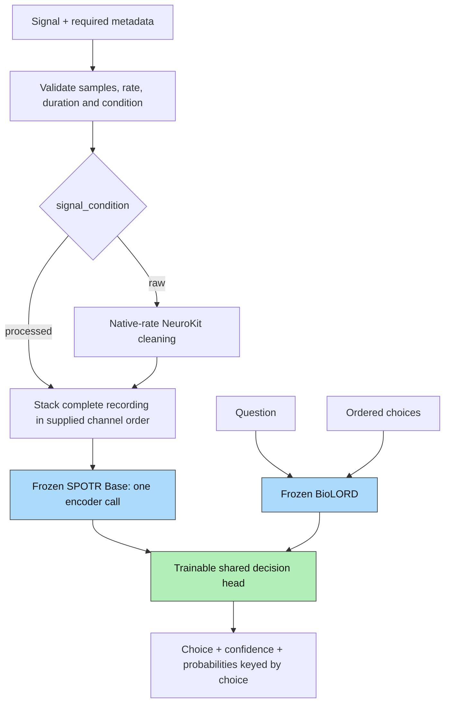

# Paya architecture

Paya uses frozen SPOTR Base and BioLORD-2023 encoders with one trainable decision head. Preprocessing has no learned parameters. Vendor-specific settings and operations are contained in [the vendor module](../paya/vendor/spotr.py). Shared code uses `SignalEncoder`; configuration and exported models identify the encoder assets explicitly with `spotr: third-party/spotr`.

The public arguments are `state`, `question` and ordered `criteria`. Metadata controls validation and raw cleaning. The head receives only signal embeddings, separate text embeddings and padding masks. Metadata, elapsed start/end, audit quality and dataset identifiers are not head features.

## Native signal formatting

Accept EEG, iEEG, ECG and PPG. All channels must have the same native sampling rate, sample count and start time. Preserve supplied channel order and stack the entire recording as `[1,C,L]`. No resampling, grouping or window splitting is performed.

Encode the complete recording once. SPOTR internally normalizes each channel before zero padding to a multiple of 200. Recordings exceeding 12,800 samples per channel are rejected before cleaning or encoding. This follows pretrained positional capacity, not a physiological duration rule.

Defaults permit 128 channels and 12,800 samples per channel. Lower resource limits can be configured. Each channel needs at least two samples for the upstream sample standard deviation; raw filters may require more. These bounds do not establish suitability for a question.

## Frozen encoders

`B` is request batch size; `M=1` is the number of signal embeddings per request; `K` is the maximum candidate count; `S=K+1` counts the question and candidates. Each encoder call has `G=1`, `C` channels and `N=2*ceil(L/200)` temporal patches. A batch of distinct recordings encodes each recording once.

### SPOTR Base

The pinned checkpoint has width 512, patch size 100, eight attention heads and 12 transformer blocks. Its official downstream representation is the global token `tokens[:,0]`. The vendored encoder preserves upstream forward operations and checkpoint keys; decoder and downstream classifiers are excluded.

| Operation | Input | Output |
| --- | --- | --- |
| Per-channel z-score, then internal zero padding | `[G,C,L]` | `[G,C,200*ceil(L/200)]` |
| Conv2D 1→32, kernel 1×25, padding 12; LayerNorm2D + GELU | `[G,1,C,100N]` | `[G,32,C,100N]` |
| Conv2D 32→512, kernel/stride 1×100; LayerNorm2D + GELU | `[G,32,C,100N]` | `[G,512,C,N]` |
| Rearrange and add learned channel/time positions | `[G,512,C,N]` | `[G,C,N,512]` |
| Self-attention across time, residual, mean over time | `[G*C,N,512]` | `[G,C,512]` |
| Self-attention across channels, residual, mean over channels | `[G*N,C,512]` | `[G,N,512]` |
| Prepend global token and concatenate both sequences | `[G,C,512]`, `[G,N,512]` | `[G,1+C+N,512]` |
| Twelve pre-RMSNorm self-attention / gated feed-forward blocks | `[G,1+C+N,512]` | `[G,1+C+N,512]` |
| Select global token | `[G,1+C+N,512]` | `[G,512]` |
| Stack one global embedding per recording | `[1,512]` per recording | `[B,1,512]`, mask `[B,1]` |

Each attention head has width 64. Transformer feed-forward layers use separate gate/up projections 512→2048, SiLU gating, and a 2048→512 down projection, with residual additions. No output-width adapter is needed. Learned channel positions make supplied channel order significant.

Published downstream processing uses 200 Hz and a 50/60 Hz notch; Paya preserves declared native rates and applies a notch only when requested. Supported types match the paper's EEG, iEEG, ECG and PPG evaluation domains. Internal z-scoring removes absolute level and scale: absolute voltage or optical intensity cannot be recovered from normalized embeddings alone. Native-rate accuracy and calibration require independent outcome evaluation.

### BioLORD-2023

Question and choices are independently encoded. MPNet maps `[N,L_t]` token IDs to `[N,L_t,768]`; masked mean pooling and L2 normalization return `[N,768]`. Text longer than 128 tokens is rejected rather than truncated. Frozen vectors are cached on CPU.

## Trainable decision head

The default head has width 256, two residual blocks, four attention heads of width 64 and 2,567,681 trainable parameters. Candidate states share one role vector and scorer; there are no candidate-position embeddings.

| Layer | Input | Output |
| --- | --- | --- |
| Stack separate question and candidates | `[B,768]`, `[B,K,768]` | `[B,S,768]` |
| Shared linear + LayerNorm | `[B,S,768]` | `[B,S,256]` |
| Add question/candidate role embeddings | `[B,S,256]`, `[2,256]` | `[B,S,256]` |
| Pre-LayerNorm, bidirectional self-attention + residual | `[B,S,256]`; Q/K/V `[B,4,S,64]` | `[B,S,256]` |
| Pre-LayerNorm and query projection | `[B,S,256]` | Q `[B,4,S,64]` |
| Signal key/value projections, 512→256 each | `[B,M,512]` | `[B,M,256]` each |
| Cross-attention, output projection + residual | Q/K/V; scores `[B,4,S,M]` | `[B,S,256]` |
| Pre-LayerNorm, linear, GELU, dropout, linear + residual | `[B,S,256]` | `[B,S,1024]→[B,S,256]` |
| Repeat residual block once | `[B,S,256]` | `[B,S,256]` |
| Final LayerNorm and shared candidate scorer | `[B,K,256]` | `[B,K]` logits |
| Masked softmax after division by fitted temperature | `[B,K]` | `[B,K]` probabilities |

Dropout defaults to 0.1. There are no elapsed-time, wavelet-scale or CLS/frame coordinates. Candidate padding is masked at the head; the encoder's internal waveform padding follows its pretrained forward pass. With one signal token, cross-attention broadcasts the projected signal value to text states; its attention weights cannot select between signal locations.

Choice is the highest-probability criterion; ties use criterion text as a deterministic key. `probabilities` maps each exact candidate string to its probability, inserting keys in candidate order. `confidence = probabilities[choice]`. Calibration describes groups of predictions and does not guarantee that an individual answer is correct.

## Training and artifact identity

Only the decision head is optimized with candidate cross-entropy. Selection NLL chooses the best checkpoint; calibration fits one global temperature on separate outcomes. Further training invalidates calibration. Frozen encoders remain in evaluation mode.

[paya/provenance.py](../paya/provenance.py) defines unchanged Paya `v1` version identifiers and shared artifact identities. The vendor module supplies the pinned signal encoder identity. Caches, checkpoints and exports bind that identity, the signal-only head input and the choice-keyed output contract. No compatibility path loads retired architectures. See [training](training.md).

Sources: [SPOTR implementation](https://github.com/5GYYYYY/SPOTR), [checkpoint](https://huggingface.co/5gyyyyy/SPOTR), [SPOTR paper](https://arxiv.org/abs/2606.21973), [BioLORD](https://huggingface.co/FremyCompany/BioLORD-2023), [NeuroKit](https://neuropsychology.github.io/NeuroKit/).
