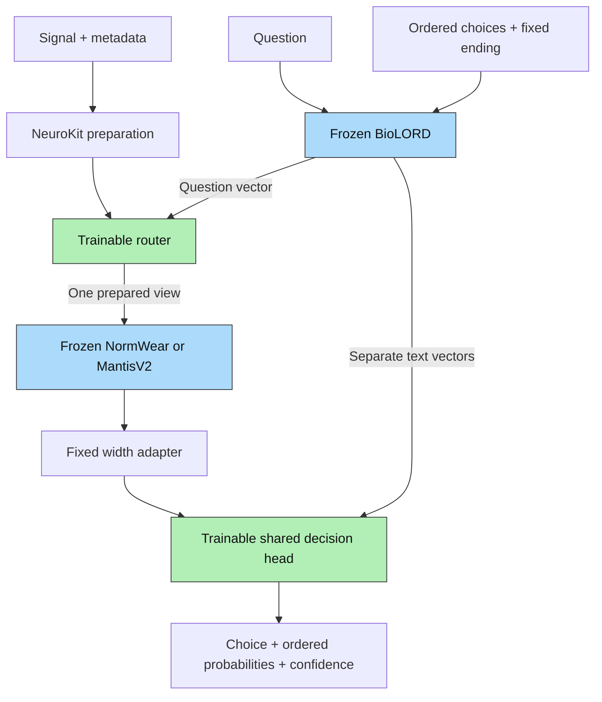

# Paya architecture

Paya uses a two-expert top-1 router and one shared decision head. NormWear, MantisV2 and BioLORD are frozen; the router and decision head are trainable. Preprocessing and encoder-output adapters have no learned parameters.

The public arguments are `state`, `question` and ordered `criteria`. The model supplies the ending `The answer is:` internally. Metadata determines units, native processing, framing and encoder compatibility before routing; neither learned component receives a metadata vector. Quality observations and dataset identifiers remain audit fields. See [preprocessing](preprocessing.md) and [training](training.md).

## Dimensions

`B` is batch size; `K` is the maximum candidate count; `S = K+2` counts question, candidates and ending. `R_N` and `R_M` count real channel/frame pairs for each prepared view. `M` is the maximum encoded signal-token count per request. Padding masks identify real candidates and encoded tokens; padding never enters a frozen signal encoder.

## Frozen encoders

### NormWear

Preparation produces 65 Hz, six-second frames. `W` is frame count and `C` is real channel count.

| Operation | Input | Output |
| --- | --- | --- |
| Waveform/difference Ricker transform | `[W,C,390]` | `[W*C,3,389,65]` |
| 9×5 strided patch projection | `[W*C,3,389,65]` | `[W*C,559,768]` |
| Append CLS and frozen positions | `[W*C,559,768]` | `[W*C,560,768]` |
| 12 transformer blocks and final LayerNorm | `[W*C,560,768]` | `[W*C,560,768]` |
| Pool 43 time rows to 8, retaining 13 scale bins and CLS | `[W,C,560,768]` | `[W,C,105,768]` |
| Pack and apply identity adapter | `[W,C,105,768]` | `[W*C*105,768]` |

Each block uses pre-LayerNorm, self-attention with 12 heads of width 64 (`768→2304` QKV, `768→768` output), and a GELU feed-forward layer `768→3072→768`, with residual additions. Every other block also applies these operations across the `C` channel CLS tokens. Pooling compresses temporal detail; it is part of the fixed representation.

### MantisV2

Each real frame contains 512 measurements. The selected output uses transformer layers 0–2 and concatenates CLS with mean patch embeddings.

| Operation | Input | Output |
| --- | --- | --- |
| Waveform/difference/statistics token generator | `[R_M,1,512]` | `[R_M,32,256]` |
| Append CLS | `[R_M,32,256]` | `[R_M,33,256]` |
| Three transformer blocks | `[R_M,33,256]` | `[R_M,33,256]` |
| Concatenate CLS and mean patch embedding | `[R_M,33,256]` | `[R_M,512]` |
| Append 256 zeros | `[R_M,512]` | `[R_M,768]` |

Each block uses RMSNorm, rotary self-attention with eight heads of width 32 (`256→768` QKV, `256→256` output), and RMSNorm followed by a gated feed-forward layer `256→1024→512→256` with SwiGLU and residual additions. The token generator retains a path for raw patch means and standard deviations. Zero-padding preserves every output coordinate; it does not align the encoders' feature meanings. Learned cross-attention handles their shared 768-wide format.

### BioLORD-2023

Each question, choice and ending is independently tokenized and encoded. For `N` uncached strings and token length `L≤128`, MPNet maps `[N,L]` IDs/masks to `[N,L,768]`. Its 12 layers use 12 self-attention heads of width 64 and `768→3072→768` feed-forward layers. Masked mean pooling and L2 normalization return `[N,768]`; vectors are cached on CPU. Longer text is rejected rather than truncated.

## Trainable router

Purpose: choose the compatible prepared encoder view using the waveform and question. Inference runs only the selected frozen signal encoder.

| Layer | Input | Output |
| --- | --- | --- |
| Shared Conv1d, kernel 9, stride 2, padding 4; GELU | NormWear `[R_N,1,390]`; Mantis `[R_M,1,512]` | `[R_N,16,195]`; `[R_M,16,256]` |
| Shared Conv1d, kernel 5, stride 2, padding 2; GELU | Above | `[R_N,32,98]`; `[R_M,32,128]` |
| Temporal mean | Each view's convolution outputs | `[R_j,32]` |
| Mean real frames/channels per request | `[R_j,32]` and owner indices | `[B,32]` per view |
| Concatenate both view summaries | Two `[B,32]` tensors | `[B,64]` |
| Question linear + GELU | `[B,768]` | `[B,128]` |
| Concatenate waveform/question; linear + GELU | `[B,192]` | `[B,64]` |
| Expert logits; compatibility mask; argmax | `[B,64]` | `[B,2]` logits; `[B]` route |

An unavailable view contributes zeros to its summary and its logit is masked to negative infinity. No handcrafted physical-summary features enter the router. Hard routing has no answer-loss gradient through argmax; training supplies detached expert-loss routing targets.

## Trainable shared decision head

Purpose: compare all choices against the encoded signal and question in one computation. Pack selected expert outputs as `[B,M,768]`. Default text-state width is 256 with four attention heads of width 64 and two residual blocks.

| Layer | Input | Output |
| --- | --- | --- |
| Stack separate question, candidates and ending | `[B,768]`, `[B,K,768]`, `[B,768]` | `[B,S,768]` |
| Shared text linear + LayerNorm | `[B,S,768]` | `[B,S,256]` |
| Add question/candidate/ending role vectors | `[B,S,256]`, `[3,256]` | `[B,S,256]` |
| Pre-LayerNorm, bidirectional self-attention + residual | `[B,S,256]`; Q/K/V `[B,4,S,64]` | `[B,S,256]` |
| Pre-LayerNorm and cross-attention query projection | `[B,S,256]` | Q `[B,4,S,64]` |
| Signal key/value projections, 768→256 each | `[B,M,768]` | K/V `[B,4,M,64]` |
| Add fixed sinusoidal time/scale/CLS positions to keys | `[B,M,3]` coordinates | `[B,M,256]` encoding, reshaped into K heads |
| Cross-attention, output projection and residual | Q/K/V; attention scores `[B,4,S,M]` | `[B,S,256]` |
| Pre-LayerNorm, linear, GELU, dropout, linear + residual | `[B,S,256]` | `[B,S,1024]→[B,S,256]` |
| Repeat the residual block once | `[B,S,256]` | `[B,S,256]` |
| Final LayerNorm and shared candidate linear scorer | Candidate states `[B,K,256]` | `[B,K,1]→[B,K]` logits |
| Masked softmax of logits divided by fitted temperature | `[B,K]` | `[B,K]` probabilities |

The default dropout is 0.1. Candidates share one role vector and scorer, with no candidate-position embeddings, preserving candidate permutation equivariance. Structural signal positions describe the prepared grid; they do not encode sensor labels. Each block costs `O(S²+S*M)` attention work rather than adding signal-token self-attention of `O(M²)`.

The returned choice is the highest-probability criterion; ties use the criterion text as a deterministic key. Probabilities retain the supplied order. Confidence equals the chosen probability. Calibration measures groups of predictions and does not guarantee an individual answer is correct.

## Identity and verification

[paya/provenance.py](../paya/provenance.py) defines Paya `v1` contracts and pinned upstream identities. Prepared states, feature caches, checkpoints, calibration and exported bundles validate the relevant identity and checksums. Package metadata reads the same central version. Upstream model names and revisions are unchanged.

Unit tests cover validation, native processing, routing, masks, permutations, gradients, caching, checkpoint/calibration bindings and training tracking. Integration tests exercise the actual pinned encoders and output shapes. Generalization, outcome calibration and latency must be measured after shared training, on independent domains and recordings.

Sources: [NormWear](https://github.com/Mobile-Sensing-and-UbiComp-Laboratory/NormWear), [MantisV2](https://github.com/vfeofanov/mantis), [BioLORD](https://huggingface.co/FremyCompany/BioLORD-2023), [NeuroKit](https://neuropsychology.github.io/NeuroKit/).
