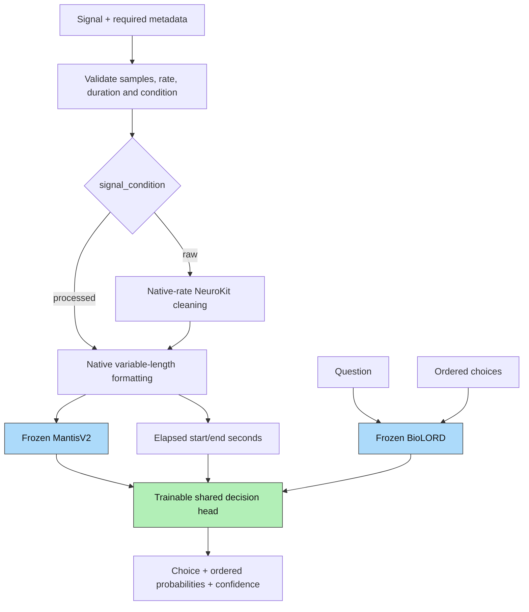

# Paya architecture

Paya uses frozen MantisV2 and BioLORD-2023 encoders with one trainable decision head. Preprocessing and interval encoding have no learned parameters.

The public arguments are `state`, `question` and ordered `criteria`. Metadata controls validation, raw cleaning and elapsed-time calculation. The head receives signal embeddings, their interval endpoints, separate text embeddings and padding masks. Sensor labels, audit quality and dataset identifiers are not head features.

## Native signal formatting

Use the supplied recording as context. For `N` samples, let `L = 32*floor(N/32)`. If `N=L`, encode `[0,N)` once. Otherwise encode `[0,L)` and `[N-L,N)`. Every sample is covered without resampling, waveform padding or additional normalization. The two overlapping windows represent the same recording, not independent measurements.

The pinned encoder calculates sample standard deviation in 32 patches. `L=32` gives one observation per patch and nonfinite statistics, so the numerical minimum is `L=64`. Raw NeuroKit filters may impose additional constraints. Sample-count acceptance does not prove that a recording supports the requested physiological inference.

Equal-length windows are stacked as `[G,1,L]`; different lengths are encoded separately. Each call contains at most `max_samples` waveform measurements. Original embedding order is restored after grouping. Defaults permit 64 channels, 1,000,000 samples per channel and 128 signal embeddings (at most two per channel). These are configurable compute limits, not physiological duration rules.

## Frozen encoders

`B` is request batch size; `M` is the maximum number of signal embeddings per request; `K` is the maximum candidate count; `S=K+1` counts the question and candidates. `G` counts equal-length windows in an encoder call.

### MantisV2

Use transformer layer index 2, concatenating CLS and mean patch embeddings. Frozen model internals retain their original normalization and statistics operations.

| Operation | Input | Output |
| --- | --- | --- |
| Waveform/difference/statistics token generator | `[G,1,L]` | `[G,32,256]` |
| Append CLS | `[G,32,256]` | `[G,33,256]` |
| Three transformer blocks | `[G,33,256]` | `[G,33,256]` |
| Concatenate CLS and mean patch embedding | `[G,33,256]` | `[G,512]` |
| Pack embeddings and their elapsed intervals | Variable window groups | `[B,M,512]`, `[B,M,2]`, mask `[B,M]` |

Each block uses RMSNorm, rotary self-attention with eight heads of width 32 and a gated feed-forward layer, with residual additions. There is no output-width adapter. Changing input length changes the encoder's pooling scale; representation quality across lengths needs evaluation.

### BioLORD-2023

Question and choices are independently encoded. MPNet maps `[N,L_t]` token IDs to `[N,L_t,768]`; masked mean pooling and L2 normalization return `[N,768]`. Text longer than 128 tokens is rejected rather than truncated. Frozen vectors are cached on CPU.

## Trainable decision head

The default head has width 256, two residual blocks, four attention heads of width 64 and 2,567,681 trainable parameters. Candidate states share one role vector and scorer; there are no candidate-position embeddings.

| Layer | Input | Output |
| --- | --- | --- |
| Stack separate question and candidates | `[B,768]`, `[B,K,768]` | `[B,S,768]` |
| Shared linear + LayerNorm | `[B,S,768]` | `[B,S,256]` |
| Add question/candidate role embeddings | `[B,S,256]`, `[2,256]` | `[B,S,256]` |
| Pre-LayerNorm, bidirectional self-attention + residual | `[B,S,256]`; Q/K/V `[B,4,S,64]` | `[B,S,256]` |
| Pre-LayerNorm and query projection | `[B,S,256]` | Q `[B,4,S,64]` |
| Signal key/value projections, 512→256 each | `[B,M,512]` | `[B,M,256]` each |
| Fixed sinusoidal start/end encoding, added to keys and values | `[B,M,2]` elapsed seconds | `[B,M,256]`, reshaped to `[B,4,M,64]` |
| Cross-attention, output projection + residual | Q/K/V; scores `[B,4,S,M]` | `[B,S,256]` |
| Pre-LayerNorm, linear, GELU, dropout, linear + residual | `[B,S,256]` | `[B,S,1024]→[B,S,256]` |
| Repeat residual block once | `[B,S,256]` | `[B,S,256]` |
| Final LayerNorm and shared candidate scorer | `[B,K,256]` | `[B,K]` logits |
| Masked softmax after division by fitted temperature | `[B,K]` | `[B,K]` probabilities |

Dropout defaults to 0.1. The interval encoding allocates half its dimensions to each endpoint, measured from the recording start in seconds. Adding time to values preserves time information even with a single signal token; adding it only to keys would have no effect in that case. There are no wavelet-scale or CLS/frame coordinates. Padding is masked at the head and never enters a frozen signal encoder.

Choice is the highest-probability criterion; ties use criterion text as a deterministic key. Probabilities retain input order, and confidence is the chosen probability. Calibration describes groups of predictions and does not guarantee that an individual answer is correct.

## Training and artifact identity

Only the decision head is optimized with candidate cross-entropy. Selection NLL chooses the best checkpoint; calibration fits one global temperature on separate outcomes. Further training invalidates calibration. Frozen encoders remain in evaluation mode.

[paya/provenance.py](../paya/provenance.py) defines unchanged Paya `v1` version identifiers and pinned upstream revisions. Structural identities distinguish variable-length formatting and elapsed-interval attention. Caches, checkpoints and exports require matching identities; no compatibility path loads retired architectures. See [training](training.md).

Sources: [Mantis implementation](https://github.com/vfeofanov/mantis), [MantisV2 paper](https://arxiv.org/abs/2602.17868), [BioLORD](https://huggingface.co/FremyCompany/BioLORD-2023), [NeuroKit](https://neuropsychology.github.io/NeuroKit/).
