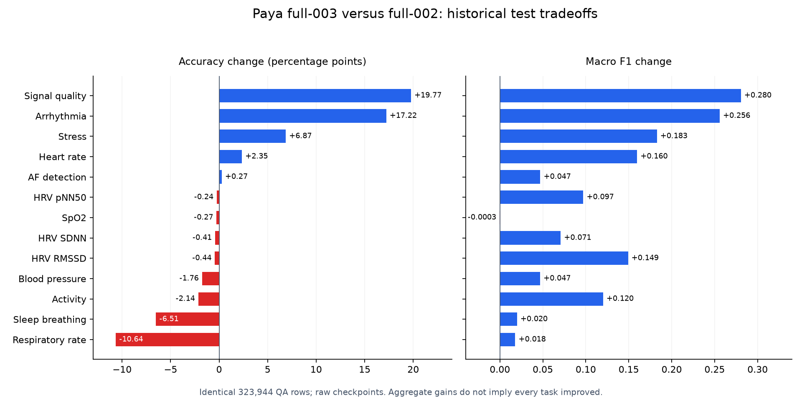

# Paya full-003: audited improvement report

2026-10-21. Completed research, 14 controlled small/development experiments, compact-head refinement, full-data training, native-input validation, independent calibration, matched historical test evaluation and latency benchmarking.

**Outcome:** all six aggregate raw test metrics improved, along with median/p95/p99 latency in the paired benchmark. The gain in pooled accuracy is small (804 additional correct QA rows), while macro F1, AUROC and probability errors improve more. Some tasks regress and several important classes remain unrecognized. This is a useful baseline improvement, not a uniformly reliable classifier.

## Matched historical test results

Both models use the same 323,944 QA rows. Mapping IDs, correct answers, candidate sets and source/subject/recording audit identities matched exactly. All reported F1/AUROC aggregates average task-level macro scores over 13 tasks. AUROC is one-vs-rest averaged over classes with both positive and negative examples. Macro F1 includes the task candidate vocabulary; absent classes receive zero F1 and their support is explicit.

| Metric | Full-002 raw | Full-003 raw | Full-003 calibrated |
| --- | ---: | ---: | ---: |
| Accuracy | 76.61% | 76.86% | 76.86% |
| Mean task macro F1 | 0.267579 | 0.378854 | 0.378854 |
| Mean task macro AUROC | 0.601885 | 0.674655 | 0.674629 |
| NLL | 0.740452 | 0.651483 | 0.651503 |
| Brier | 0.381641 | 0.345870 | 0.346460 |
| ECE, 15 bins | 0.072581 | 0.021148 | 0.025102 |

Raw-versus-raw is the primary comparison; both calibrated variants also remain in the underlying comparison JSON. No artifact or temperature was selected using test results. The reference test errors had already informed the research direction, so this is a **retrospective historical comparison**, not an unseen benchmark. QA rows can share waveforms and subjects; no subject-cluster confidence intervals were computed, and no statistical significance is claimed for the 0.25 percentage-point accuracy gain.

## Per-task outcomes

Accuracy improves in 5/13 tasks; macro F1 improves in 12/13. The aggregate gain must be read alongside the respiratory/sleep-breathing regressions.

| Task | QA rows | Old accuracy | New accuracy | Old macro F1 | New macro F1 | New AUROC |
| --- | ---: | ---: | ---: | ---: | ---: | ---: |
| Activity | 5,320 | 39.51% | 37.37% | 0.1134 | 0.2335 | 0.7423 |
| AF detection | 32,560 | 85.29% | 85.56% | 0.4603 | 0.5073 | 0.5788 |
| Arrhythmia | 5,243 | 49.53% | 66.76% | 0.2456 | 0.5014 | 0.8812 |
| Blood pressure | 23,138 | 64.21% | 62.45% | 0.1564 | 0.2032 | 0.5899 |
| Heart rate | 78,730 | 87.62% | 89.97% | 0.5580 | 0.7177 | 0.9211 |
| HRV pNN50 | 41,709 | 78.12% | 77.88% | 0.2924 | 0.3894 | 0.6760 |
| HRV RMSSD | 41,709 | 72.39% | 71.96% | 0.2800 | 0.4291 | 0.6717 |
| HRV SDNN | 41,709 | 85.05% | 84.65% | 0.3064 | 0.3771 | 0.7186 |
| Respiratory rate | 9,556 | 50.83% | 40.18% | 0.2288 | 0.2466 | 0.5458 |
| Sleep breathing | 29,754 | 60.96% | 54.45% | 0.1894 | 0.2092 | 0.4359 |
| SpO2 | 4,492 | 98.02% | 97.75% | 0.2475 | 0.2472 | 0.4548 |
| Signal quality | 9,427 | 63.41% | 83.19% | 0.2587 | 0.5392 | 0.8972 |
| Stress | 597 | 39.53% | 46.40% | 0.1417 | 0.3244 | 0.6572 |

## Remaining failures and coverage

- AF detection: **241/4,789** AF examples correct, up from zero. Positive recall is still only **5.03%**; precision is 61.01%. The 85.56% task accuracy is dominated by non-AF examples.
- Hypoxemia: **0/89** examples correct (84 mild, 1 moderate, 4 severe). High SpO2 accuracy continues to reflect its normal-class prevalence.
- Severe sleep-breathing: **0/2,219** correct. Moderate sleep-breathing has no test examples; severe has no inherited validation examples.
- Zero recall also remains for hypertension stage 1, hypertensive crisis, unusual symmetric quality, tachypnea, normal pNN50, amusement, and two activity labels. Per-class support, precision, recall and confusion counts are preserved in the JSON comparison.
- Respiratory-rate accuracy fell **50.83% -> 40.18%** and sleep-breathing **60.96% -> 54.45%**. These are unresolved failures despite improved pooled metrics.

The inherited validation corpus contains only one moderate-hypoxemia example. The independent calibration role contains 10/13 tasks and no activity, AF or stress examples. Classes with absent or tiny support do not establish dependable class-specific performance. Labels were neither invented nor merged.

## What changed and what was rejected

- The signal/text encoders and public state/question/criteria interface stayed fixed. The trainable attention head (2,567,681 parameters) was replaced by an optional 128-wide interaction head (264,065 parameters) with explicit signal-question/candidate products.
- Label smoothing 0.05 covers real candidates only. Moderate class weighting was tested and rejected for this full run because its accuracy tradeoff did not meet the joint validation objective.
- Frozen FP32 features are verified once in a recoverable bank; batches gather those features and cached separate text vectors on the GPU. This removes repeated Python waveform conversion and per-row device transfers during optimization.
- Training visits every retained row once per epoch using deterministic global permutations. Single-token attention has an equivalent inference shortcut; old attention checkpoints remain loadable.
- No dataset membership, waveform, QA answer, class vocabulary or preprocessing exclusion changed during this cycle. No additional raw dataset copy was created.

The same-row/same-budget development controls, failed memorization generalization, class-weighting tradeoffs and research references are in [the experiment ledger](../experiments.md). The combined full-run gain cannot be attributed to architecture alone: loss regularization and global sampling/data access also changed.

## Training and validation

| Role | QA rows |
| --- | ---: |
| Train | 1,637,289 |
| Selection | 196,707 |
| Independent calibration | 21,342 |
| Test | 323,944 |

Three full epochs; batch 512; 9,594 optimizer updates; AdamW learning rate 0.0003, weight decay 0.01; no class weighting. Full selection NLL was checked every 1,599 steps. The selected checkpoint is **step 4,797**, approximately 1.5 passes through training data (midway through epoch 2). All three epochs completed; the last checkpoint was not substituted for the selected one.

Selected native-input validation: accuracy **69.57%**, NLL **0.761795**, Brier **0.429431**, ECE **0.079107**. Its native public-input score reproduced the frozen-bank score within the declared numerical tolerance. Selected task macro F1/AUROC were **0.390281/0.727249**.

## Calibration

Global temperature **1.048308** was fit only on independent calibration outcomes. Calibration-set NLL improved 0.720900 -> 0.720216. The small fitting-set gain did not transfer to test: test NLL changed 0.651483 -> 0.651503, Brier 0.345870 -> 0.346460, and ECE 0.021148 -> 0.025102. Accuracy and F1 are unchanged. Both artifacts/results are retained; calibration is not claimed as an improvement.

## Latency and runtime

The larger final paired check ran 1,300 requests per case on the same idle RTX 2080 Ti, with identical 13 native processed PPG inputs (10 seconds, 125 Hz), interleaved seeded case order, synchronized CUDA, warmed text embeddings and no signal-feature cache. Public preparation and frozen signal encoding are included; cold process startup, network/service overhead and concurrency are excluded.

| Final paired case | Median ms | p95 ms | p99 ms |
| --- | ---: | ---: | ---: |
| Reference original path | 13.627 | 17.082 | 18.789 |
| Reference with equivalent shortcut | 13.286 | 16.698 | 18.584 |
| Full-003 calibrated | 11.915 | 14.751 | 16.209 |

Paired median latency is **12.6% lower**; p95 is **13.6% lower**. Baseline probabilities were identical under the equivalent shortcut on the checked requests.

The original standalone full-run timing is also retained: median 12.297 ms, p95 15.185 ms, p99 16.315 ms over 130 requests. Its p95 was worse than the earlier standalone reference measurement; this discrepancy motivated the larger paired check. It was not discarded. Fresh model construction took 3.066 seconds and the first request with a cold text model took 1582.0 ms. These are not cold-process startup measurements.

Feature-bank preparation: **352.81 seconds**. The optimizer-loop timing including its periodic selection checks: **151.56 seconds**, excluding earlier model/bank initialization. Full launch through all evaluation/finalization: **17.09 minutes**, plus **5.88 minutes** for preceding bank preparation. Existing validated encoder features were reused; heads, loaders and cache conditions differ from the previous 104.8-minute run, so this is not a controlled isolated throughput speedup. Peak recorded PyTorch allocation during training was **4158.5 MiB**; memory allocation is not compute utilization.

## Verification and artifacts

- 167 unit tests passed before full training. Frozen encoder, numerical equivalence, candidate permutation, full epoch coverage, bank corruption/recovery and public checkpoint reload checks passed.
- Native train/test membership and the existing selection/calibration grouping protocol were preserved. All four roles were audited for shared known subject/recording/waveform identities.
- 32 small report snapshots were checksum-verified locally; weighted task counts/accuracy/NLL/Brier and class-correct totals agree with overall metrics. No datasets or checkpoints were downloaded.
- Exact training/evaluation code revision: `48754f3b86cb0c29e04673acfefd6f2f6418f55e`. Later documentation/recovery hardening does not alter these completed weights or reported predictions.
- Local raw JSON/Markdown reports and checksum manifest: `.temp/reports/improvement/`.
- GPU artifacts: `/root/autodl-tmp/paya/runs/paya-full-003/training/best.pt` (raw public checkpoint), `calibrated.pt`, `full-003-interaction-smooth/last.pt` (optimizer/RNG recovery), and report/prediction files under the same run directory.
- [Online W&B run](https://forge.coreweave.com/wandb/yeabsiramersha58-beijing-institute-of-technology/Paya/runs/v2xwzlsv). Online training delivery was independently verified through sampled step 7,260, and final test accuracy/macro F1 plus the finished state were verified directly online; local checkpoints remain authoritative. Eleven earlier development runs received explicit effective-recipe audit annotations. Model-artifact uploads remain disabled.

One full test-scoring pass was performed for this nominated full-data candidate; the paired latency check reused 13 native inputs without label-driven tuning. Remaining work should use fresh train/selection protocols or genuinely new evaluation data; repeatedly selecting against this historical test would make the comparison less informative. No publication or instance changes were performed.

## Recovery check and durable metrics

After the full run completed, two tiny scratch paths checked GPU recovery: one ran uninterrupted to step 200; the other was deliberately interrupted after committed step 100 and resumed to 200. Final head tensors were bit-for-bit identical (maximum difference 0), selection history matched, and the online run ID was preserved. The completed full-model weights and test outcomes were untouched. Post-run configuration/source hardening passed 168 local unit tests.

[Machine-readable comparison and verification snapshot](paya-full-003-metrics.json) preserves all aggregate/per-task/class metrics, both calibration variants, both latency measurements and the recovery/tracking receipts without raw samples, audit identities or credentials.
