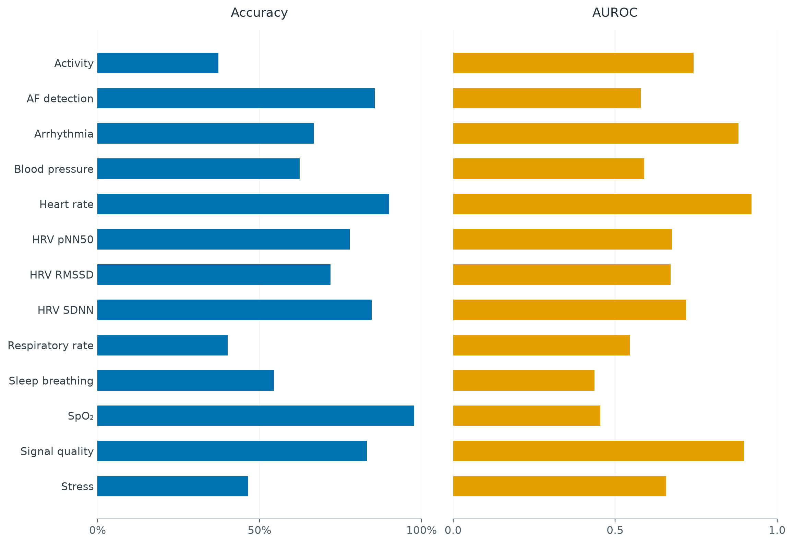

# Results

All plots and scores describe the same raw checkpoint: **full-003, step 4,797, temperature 1**. Test size: **323,944 QA rows**, across 13 tasks.

| System metric | Value |
| --- | ---: |
| Accuracy | 76.8599% |
| Mean task macro AUROC | 0.674655 |
| ECE, 15 bins | 0.021148 |
| Mean task macro F1 | 0.378854 |
| NLL | 0.651483 |
| Brier | 0.345870 |
| Median latency | 12.30 ms |
| p95 / p99 latency | 15.81 / 17.58 ms |

| Task | Rows | Accuracy | AUROC |
| --- | ---: | ---: | ---: |
| Activity | 5,320 | 37.37% | 0.7423 |
| AF detection | 32,560 | 85.56% | 0.5788 |
| Arrhythmia | 5,243 | 66.76% | 0.8812 |
| Blood pressure | 23,138 | 62.45% | 0.5899 |
| Heart rate | 78,730 | 89.97% | 0.9211 |
| HRV pNN50 | 41,709 | 77.88% | 0.6760 |
| HRV RMSSD | 41,709 | 71.96% | 0.6717 |
| HRV SDNN | 41,709 | 84.65% | 0.7186 |
| Respiratory rate | 9,556 | 40.18% | 0.5458 |
| Sleep breathing | 29,754 | 54.45% | 0.4359 |
| SpO₂ | 4,492 | 97.75% | 0.4548 |
| Signal quality | 9,427 | 83.19% | 0.8972 |
| Stress | 597 | 46.40% | 0.6572 |

Accuracy and ECE pool QA rows. AUROC is one-versus-rest, averaged over supported classes within tasks and then equally across tasks; undefined class AUROCs are omitted. ECE uses 15 equal-width confidence bins. Macro F1 includes the task candidate vocabulary, assigning zero to absent classes. QA rows can share subjects and waveforms; no subject-bootstrap confidence intervals are claimed.

Latency was measured on the exact raw checkpoint over 1,300 public-API requests on an idle RTX 2080 Ti, batch one, using 13 native processed 10-second PPG inputs at 125 Hz. CUDA timing was synchronized. Text embeddings were warm; signal-feature caching was disabled. Preparation, signal encoding and decision scoring are included. Process startup, network/service overhead and concurrent load are excluded. Earlier calibrated-model timings are not substituted for these release timings.

This is a retrospective historical benchmark. Minority-class performance remains limited: AF recall is 5.03%, hypoxemia recall is 0/89 and severe sleep-breathing recall is 0/2,219. Moderate sleep breathing has no test positives; inherited validation has no severe sleep-breathing positives and only one moderate-hypoxemia positive. Calibration lacks activity, AF and stress examples. Aggregate scores do not establish reliable performance for every class or modality.

Verification: 155 local unit tests passed; the isolated GPU suite passed all 156 tests, including the pretrained integration test. The cleaned runtime matched probabilities exactly on 13 real inputs, and the complete inference export reloaded with the same learned-weight identity.

Checkpoint SHA-256: `461b939b19ef59bfa05725c69438b2e8332e031b2586aeab9234fe848c633eba`. [Machine-readable results](docs/metrics.json).
